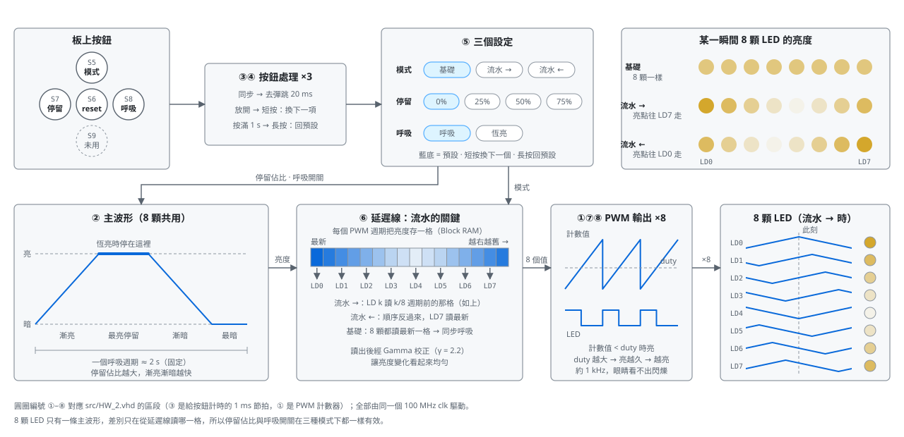
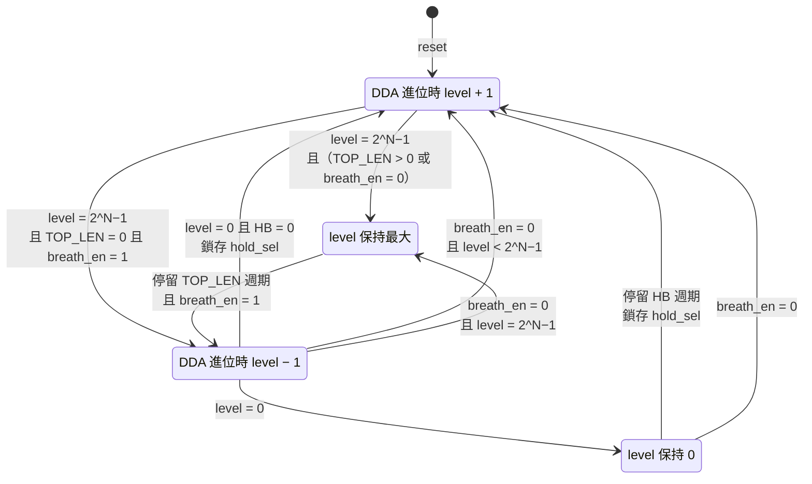
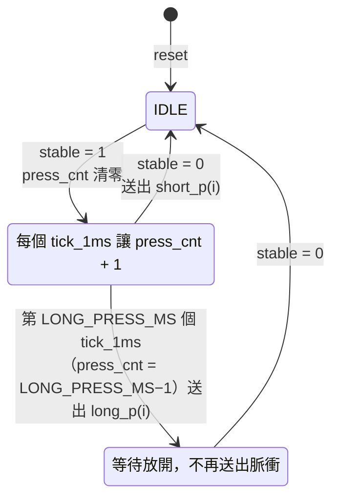

# HW2 8 顆 LED 呼吸燈規格

## 1. 目標

以 PWM 驅動板上 8 顆單色 LED，亮度依固定週期平滑地「漸亮 → 漸暗」循環。以按鈕切換模式：
**基礎**（8 顆同步呼吸）或**流水**（呼吸波形依序延遲，亮光沿 LED 流動，可選方向），並可調整
最亮停留時間與呼吸／恆亮。設計為全同步電路，只有單一時脈域，所有時間參數皆以 generic 設定，
方便在模擬時縮短時間。

- 目標板：e-elements EGO-XZ7（`xc7z020clg484-1`，100 MHz），腳位見 `constraints/HW_2.xdc`
- 語言：VHDL（`ieee.numeric_std`）；設計為 VHDL-93，測試檔需以 VHDL 2008 編譯
- Top 模組：`HW_2`，測試檔：`HW_2_tb`

## 2. 架構



上排是操作（按鈕 → 設定，以及三種模式下 8 顆 LED 的樣子），下排是資料流（主波形 → 延遲線 → PWM → LED）。圖中圓圈編號對應 `src/HW_2.vhd` 的區段：

| Process | 功能 | 主要訊號 | 章節 |
|---|---|---|---|
| ① PWM 計數器 | 前除頻 + N bit 計數，標出 PWM 週期結束點 | `div_cnt`、`pwm_cnt`、`pwm_end` | §4 |
| ② 亮度 FSM | 主波形：三角波 + 最亮／最暗停留，週期固定 | `b_state`、`acc`、`level`、`sel_l` | §5 |
| ③ 1 ms 節拍 | 按鈕計時的時間基準 | `tick_cnt`、`tick_1ms` | §7.2 |
| ④ 按鈕介面 ×3 | 同步、去彈跳、短／長按判斷（`gen_btn`） | `stable`、`short_p`、`long_p` | §7.2 |
| ⑤ 設定暫存器 | 保存設定 | `mode`、`hold_sel`、`breath_en` | §7.1 |
| ⑥ 流水延遲線 | 主波形存入歷史 RAM，依模式以不同延遲讀出 8 顆 → Gamma | `hist_ram`、`wr_ptr`、`fill`、`rd_k`、`duty_nxt` | §5.2、§6 |
| ⑦ duty 影子暫存器 ×8 | 只在 PWM 週期交界更新 duty | `duty` | §4.2 |
| ⑧ 比較器與輸出 ×8 | `pwm_cnt < duty(k)`，依極性經暫存器輸出 | `led_reg` | §4.2 |

全部 process 由 `clk` 驅動，時序控制一律使用單拍致能脈衝（`pwm_end`、`pwm_end_d`、
`tick_1ms`、`short_p`、`long_p`），不產生衍生時脈。8 顆 LED 共用同一條主波形，差別只在讀
歷史 RAM 的延遲，因此停留佔比、呼吸開關在每種模式下行為都一致。

## 3. 介面

### 3.1 Generic

| 名稱 | 型別 | 預設值 | 說明 |
|---|---|---|---|
| `CLK_FREQ_HZ` | natural | 100_000_000 | 系統時脈頻率（EGO-XZ7 為 100 MHz） |
| `PWM_BITS` | natural | 8 | PWM 解析度 N，duty 範圍 0 ~ 2^N−1 |
| `PWM_DIV` | natural | 390 | PWM 計數器前除頻，每 `PWM_DIV` 個 clk 計數一次 |
| `CYCLE_PERIODS` | natural | 2048 | 呼吸週期（PWM 週期數），約 2.04 s；與最亮佔比無關 |
| `HOLD_BOTTOM_PERIODS` | natural | 0 | 最暗點停留的 PWM 週期數 |
| `GAMMA_EN` | boolean | true | 是否啟用 gamma 校正 |
| `LED_ACTIVE_LOW` | boolean | false | LED 低電位點亮時設為 true |
| `DEBOUNCE_MS` | natural | 20 | 去彈跳：按鈕需連續穩定的節拍數 |
| `LONG_PRESS_MS` | natural | 1000 | 長按門檻節拍數 |
| `BTN_ACTIVE_LOW` | boolean | false | 按鈕按下為低電位時設為 true |

內部常數：

- `TICK_DIV = CLK_FREQ_HZ / 1000`：1 ms 節拍的除頻值，模擬時改小 `CLK_FREQ_HZ` 即可縮短。
  `CLK_FREQ_HZ` 必須是 1000 的倍數，否則節拍不是整 1 ms；以 elaboration 時的 `assert` 檢查。
- `FLOW_STEP = CYCLE_PERIODS / 8`：流水時相鄰兩顆 LED 的延遲（PWM 週期），見 §6。

### 3.2 Port

| 名稱 | 方向 | 寬度 | 說明 |
|---|---|---|---|
| `clk` | in | 1 | 系統時脈 |
| `reset` | in | 1 | 同步、高電位有效（與 HW1 相同） |
| `btn_mode` | in | 1 | 切換模式：基礎 / 流水 → / 流水 ←，見第 7 節 |
| `btn_hold` | in | 1 | 切換最大亮度佔比，見第 7 節 |
| `btn_breath` | in | 1 | 切換呼吸／恆亮，見第 7 節 |
| `led` | out | 8 | PWM 輸出，`led(k)` 接 LD k，各自經暫存器輸出 |

## 4. PWM 參數

### 4.1 計算式

```text
f_pwm = CLK_FREQ_HZ / (PWM_DIV × 2^PWM_BITS)
duty  = duty(k) / 2^PWM_BITS
```

預設值：100 MHz / (390 × 256) ≈ **1001.6 Hz**，解析度 8 bit（256 階）。

| 參數 | 值 | 理由 |
|---|---|---|
| PWM 頻率 | ≈ 1 kHz | 遠高於人眼閃爍門檻（約 100 Hz），又低到 LED 驅動與走線不受影響 |
| 解析度 | 8 bit | 配合 gamma 後暗部仍有足夠階數；若暗部有明顯跳階，可改為 10 bit |
| duty 範圍 | 0 ~ 255 | 0 = 全暗；255 = 255/256 ≈ 99.6%（不需要 100%） |

### 4.2 硬體行為

- 前除頻器 `div_cnt`：0 ~ `PWM_DIV`−1 循環。
- PWM 計數器 `pwm_cnt`（`PWM_BITS` bit）：`div_cnt` 歸零時加 1，自然溢位回 0。
- `pwm_end`（組合訊號）：`div_cnt = PWM_DIV−1` 且 `pwm_cnt = 2^N−1`，即 `pwm_cnt` 即將回到 0 的那一拍。
- 輸出：`led(k) <= '1' when pwm_cnt < duty(k) else '0'`（再依 `LED_ACTIVE_LOW` 反相），
  經暫存器輸出，避免組合邏輯毛刺。8 顆共用同一個 `pwm_cnt`。
- **duty 只在 `pwm_end` 時更新**（影子暫存器 ⑦），確保單一 PWM 週期內 duty 不變，
  不會產生不完整的脈波。
- 時序：`pwm_end` 時 `level` 更新、`duty` 載入 `duty_nxt`；`duty_nxt` 是上一個 `pwm_end` 後
  由延遲線算出的值（§6.2），所以 LED 亮度固定比 `level` 晚一個 PWM 週期。所有 LED、所有模式
  都延遲同樣時間，不影響波形。

## 5. 過渡函數（亮度波形）

### 5.1 線性三角波

② 產生一條主波形 `level`，8 顆 LED 都由它衍生。時間單位為 PWM 週期（每個 `pwm_end` 更新一次）。
一個呼吸週期固定為 `CYCLE_PERIODS`，分成四段：

```text
CYCLE_PERIODS = RAMP_LEN（漸亮） + TOP_LEN（最亮） + RAMP_LEN（漸暗） + HOLD_BOTTOM_PERIODS（最暗）
```

`TOP_LEN` 由最亮佔比決定（5.3），剩下的時間平分給漸亮與漸暗。所以佔比改變時，
斜坡會跟著變快或變慢，**週期不變**。



**斜坡：DDA（數位微分分析器）**

斜坡要在 `RAMP_LEN` 個 PWM 週期內走完 R = 2^N − 1 步，每步不一定是整數個週期
（例如 1024 / 255 ≈ 4.02）。以累加器 `acc` 做 Bresenham 式均勻分配，不需除法器：

```text
每個 pwm_end：
    if acc + R >= RAMP_LEN then  acc <= acc + R − RAMP_LEN;  level ± 1
    else                         acc <= acc + R
```

- 從 `acc = 0`、`level = 0` 開始，第 k 個週期後 `level = ⌊k × R / RAMP_LEN⌋`，
  第 `RAMP_LEN` 個週期剛好到達 R，所以漸亮與漸暗各精確佔 `RAMP_LEN` 個週期。
- 每個週期最多走一步，因此要求 `RAMP_LEN ≥ R`；以 elaboration 時的 `assert` 檢查
  （預設值最短的斜坡為 256 ≥ 255）。
- 硬體：一個加法器、一個比較器、`acc` 暫存器；`RAMP_LEN` 是由 `sel_l` 選擇的常數。

其他細節：

- 狀態：`UP`、`HOLD_TOP`、`DOWN`、`HOLD_BOTTOM` 四狀態 FSM，寫法與 HW1 一致。
- 停留狀態以 `hold_cnt` 計數 PWM 週期，停留 0 個週期時直接跳過該狀態。

呼吸週期：

```text
T_breath = CYCLE_PERIODS / f_pwm = 2048 / 1001.6 ≈ 2.04 s（約 0.49 Hz）
```

常見舒適範圍約 2 ~ 4 s，調整 `CYCLE_PERIODS` 即可（例如 3072 ≈ 3.07 s、4096 ≈ 4.09 s）。

### 5.2 Gamma 校正

人眼對亮度的感受接近對數，線性 duty 會讓燈「很快變亮、長時間停在亮處」。因此在 duty 前
加入 gamma 查表：

```text
gamma(x) = round( (2^N − 1) × (x / (2^N − 1))^2.2 )
```

- 實作為 `2^N × N bit` 的常數 ROM（預設 256 × 8 bit），以 VHDL 函式在 elaboration 時由
  `ieee.math_real` 計算產生，不需手動輸入表格；Vivado 會推論成 LUT/分散式 ROM。
- 只有一份 ROM，放在延遲線讀出之後，8 顆 LED 分時共用（§6.2）。
- 性質：`gamma(0) = 0`、`gamma(2^N−1) = 2^N−1`、單調不減；以 elaboration 時的 `assert` 檢查。
  所以最亮 duty 為 `2^N−1`（預設 255/256）。
- `GAMMA_EN = false` 時直接旁路，用於對照比較。

### 5.3 最大亮度時間佔比（`hold_sel`）

最亮停留 `TOP_LEN` 是週期的固定百分比。三張表（`TOP_NOM`、`RAMP_LEN`、`TOP_LEN`）都在
elaboration 時由 generic 算成常數，硬體只是 4 選 1 的常數多工器：

```text
TOP_NOM(i)  = CYCLE_PERIODS × {0, 25, 50, 75}%
RAMP_LEN(i) = (CYCLE_PERIODS − HB − TOP_NOM(i)) / 2
TOP_LEN(i)  = CYCLE_PERIODS − HB − 2 × RAMP_LEN(i)    -- 吸收除以 2 的餘數，總和剛好等於週期
```

| `hold_sel` | 最亮佔比 | `TOP_LEN` | `RAMP_LEN`（單程） | 單程斜坡時間 | 呼吸週期 |
|---|---|---|---|---|---|
| `00` | 0% | 0 | 1024 | 1.02 s | 2.04 s |
| `01` | 25% | 512 | 768 | 0.77 s | 2.04 s |
| `10` | 50% | 1024 | 512 | 0.51 s | 2.04 s |
| `11` | 75% | 1536 | 256 | 0.26 s | 2.04 s |

（以預設 `CYCLE_PERIODS = 2048`、`HOLD_BOTTOM_PERIODS = 0` 計算。）

- 佔比指「亮度停在最大值」的時間比例；**週期固定，佔比越高斜坡越快**。
- 百分比寫在 `TOP_NOM` 常數，要改成其他比例只需改這一行，不增加硬體。
- `hold_sel` 在每個週期開始（離開最暗點）時鎖存到 `sel_l`，整個週期的漸亮、停留、
  漸暗都用同一組長度；按鈕切換從下一個週期開始生效，不會讓當前週期變長或變短。
- 流水模式下，新的佔比跟著波形依序傳到後面的 LED。

### 5.4 呼吸開關（`breath_en`）

| `breath_en` | 行為 |
|---|---|
| `'1'` | 正常呼吸，依 5.1 循環 |
| `'0'` | 恆亮：`level` 平滑升到最大後停在 `HOLD_TOP` |

- 關閉時若在 `DOWN` 或 `HOLD_BOTTOM`，轉回 `UP` 繼續漸亮（`DOWN` 尚未走第一步、仍在最大值時
  直接進 `HOLD_TOP`）；若在 `UP` 則照常升到最大。亮度不會跳變。
- 關閉期間停在 `HOLD_TOP`；重新開啟後，停滿 `TOP_LEN` 個週期（已停留的週期也算）即進入 `DOWN`。
- 被關閉打斷的那個週期長度不固定；恢復後從下一個完整週期起，週期再回到 `CYCLE_PERIODS`。
- 流水模式下關閉：主波形升到最亮後，8 顆依延遲順序一顆顆升到最亮並保持；重新開啟後，
  領頭的 LED 先開始變暗，波形再依序流過其他 LED。

## 6. 模式與流水延遲線

### 6.1 模式（`mode`）

| `mode` | 名稱 | 行為 |
|---|---|---|
| `00` | 基礎 | 8 顆同步呼吸，亮度完全相同 |
| `01` | 流水 → | LD k 比 LD0 晚 k × `FLOW_STEP` 個 PWM 週期，亮光由 LD0 流向 LD7 |
| `10` | 流水 ← | LD k 比 LD7 晚 (7 − k) × `FLOW_STEP` 個 PWM 週期，亮光由 LD7 流向 LD0 |
| `11` | 保留 | 行為同 `00` |

`FLOW_STEP = CYCLE_PERIODS / 8`（預設 256 個 PWM 週期 ≈ 0.26 s）。8 顆的延遲剛好平均分佈在
一個呼吸週期內，所以任何時刻 8 顆分別處在呼吸的 8 個相位上，看起來是一道連續、循環的波。

### 6.2 延遲線硬體（⑥）

不為每顆 LED 各做一個 FSM，而是把主波形存起來再以不同延遲讀出：

- **歷史 RAM** `hist_ram`：深度 `2^HIST_BITS`（≥ 7 × `FLOW_STEP` + 1，預設 2048）、寬度 N bit，
  寫入位址 `wr_ptr` 每個 PWM 週期加 1、自然溢位，即環狀緩衝。預設 2048 × 8 bit = 16 Kbit，
  合成為半個 Block RAM（一個 RAMB18）。
- **寫入**：`pwm_end` 時 `level` 更新，下一拍（`pwm_end_d`）把新的 `level` 寫入 `wr_ptr`，並記下
  `base = wr_ptr`。
- **讀出**：接著 8 拍依序讀 LD0 ~ LD7，位址 `base − 偏移(k)`；偏移由 `mode` 決定（§6.1），
  基礎模式偏移皆為 0。RAM 為同步讀，資料下一拍出來，經 Gamma ROM 存入 `duty_nxt(k)`。
- **時序**：寫入 1 拍 + 讀出 8 拍 + RAM 與 Gamma 各 1 拍延遲，`pwm_end` 後約 11 個 clk 完成，
  必須早於下一個 `pwm_end`；以 elaboration 時的 `assert`（PWM 週期 ≥ 16 clk）檢查。
  預設 PWM 週期為 99,840 clk，綽綽有餘。
- 只用一個 RAM 讀埠、一份 Gamma ROM，8 顆分時共用，硬體與 LED 數量幾乎無關。

### 6.3 Reset 後的延遲線

RAM 不隨 reset 清除（Block RAM 不支援），reset 後裡面還留著舊的波形。以 `fill` 記錄 reset 後
已寫入的筆數（飽和於 7 × `FLOW_STEP` + 1）；讀出位址的偏移 ≥ `fill` 時，視為 0（全暗）。
因此 reset 後立刻切到流水模式，LD k 會保持全暗，直到主波形經過 k × `FLOW_STEP` 個週期傳到它。

### 6.4 切換模式

- 以按鈕切換 `mode` **立即生效**：下一個 PWM 週期起，每顆 LED 直接改讀新的延遲位置。
- 因此切換瞬間各 LED 會跳到新位置的亮度（例如由基礎切到流水時，原本同亮度的 8 顆立刻分散開）；
  為了讓操作有即時回饋，這個跳變可接受。
- 主波形本身不受影響，`level` 與 `hold_sel`、`breath_en` 的狀態都延續。

## 7. 按鈕互動

### 7.1 操作對照

| 按鈕 | 短按（< 1 s） | 長按（≥ 1 s） |
|---|---|---|
| `btn_mode` | 模式 `00 → 01 → 10 → 00`（基礎 → 流水 → → 流水 ← → 基礎，跳過保留的 `11`） | 模式回到預設 `00`（基礎） |
| `btn_hold` | 最亮佔比 `00 → 01 → 10 → 11 → 00` | 最亮佔比回到預設 `00` |
| `btn_breath` | 呼吸／恆亮切換 | 回到預設「呼吸」 |

- 規則一致：**短按 = 下一個選項，長按 = 該項回預設**。要一次回復全部設定，用 `reset`。
- 三顆按鈕各自獨立處理，同時按下時各自生效，互不影響。

### 7.2 按鈕訊號處理

每顆按鈕一套相同電路，全部由 `tick_1ms` 驅動，時間不受 PWM 參數影響：

1. **極性與同步**：`btn_x xor BTN_ACTIVE_LOW` 後經兩級正反器同步。
2. **去彈跳**：每個 `tick_1ms` 比較同步後的值與目前穩定值 `stable`；連續 `DEBOUNCE_MS`
   拍不同才更新 `stable`，否則計數器清零。按下與放開都需穩定 20 ms。
3. **短／長按 FSM**：以 `stable` 為輸入，輸出單拍脈衝 `short_p(i)`、`long_p(i)`（`i` = 0 / 1 / 2 對應 mode / hold / breath）。



- 短按在**放開時**觸發，才能與長按區分；長按在滿 1 s 時立即觸發，不必等放開。
- 一次按壓只會產生一個脈衝：短按或長按擇一。
- 每顆按鈕的硬體：同步 2 FF、去彈跳計數器 5 bit、`press_cnt` 10 bit、3 狀態 FSM。

### 7.3 設定生效時機

| 設定 | 生效時機 | 理由 |
|---|---|---|
| `mode` | 下一個 PWM 週期（立即） | 按下後需馬上看到變化；切換瞬間的跳變可接受，見 6.4 |
| `hold_sel` | 下一個呼吸週期開始 | 整個週期用同一組長度，週期不會被拉長或縮短，見 5.3 |
| `breath_en` | 立即，依 5.4 平滑過渡 | FSM 本身保證亮度不跳變 |

### 7.4 狀態指示

8 顆 LED 全部用來呼吸，沒有空閒 LED 顯示設定，所以不輸出 `status`。設定可由燈的樣子判斷：
模式看 8 顆是同步還是流動、往哪個方向；呼吸開關看是否恆亮；`hold_sel` 看最亮停留長短
（最多延遲一個呼吸週期才看得到）。

## 8. Reset 行為

`reset = '1'` 時所有計數器歸零，`level = 0`，FSM 回到 `UP`，`sel_l`、`acc` 清為 0；延遲線
`wr_ptr`、`fill` 歸零、`duty_nxt` 與 `duty` 清為 0，LED 輸出為熄滅電位。設定暫存器回到預設：
`mode = 00`、`hold_sel = 00`、`breath_en = '1'`；按鈕 FSM 回到 `IDLE`。歷史 RAM 不清除，
由 `fill` 遮掉舊資料（6.3）。

## 9. 驗證計畫（`HW_2_tb`）

模擬時覆寫 generic 以縮短時間：`PWM_BITS = 4`、`PWM_DIV = 2`（PWM 週期 32 clk）、
`CYCLE_PERIODS = 192`（`FLOW_STEP = 24`）、`HOLD_BOTTOM_PERIODS = 16`、
`CLK_FREQ_HZ = 10_000`（1 ms = 10 clk）、`DEBOUNCE_MS = 3`、`LONG_PRESS_MS = 20`。

- 以每個 PWM 週期 8 顆 LED 的高電位 clk 數還原 duty，並保留最近 512 個週期的歷史，用來比對流水延遲。
- 設定暫存器（`mode`、`hold_sel`、`breath_en`）以 VHDL-2008 external name 直接讀取，
  因此測試檔需以 VHDL 2008 編譯（`Create-Project.tcl` 已設定）。
- 同時例化高電位有效版與 `LED_ACTIVE_LOW = BTN_ACTIVE_LOW = true` 版，比對極性。
- `run all` 約 2.61 ms 跑完，印出 PASS / FAIL。

| 項目 | 檢查方式 |
|---|---|
| PWM 週期 | 以 P = `PWM_DIV × 2^N` 個 clk 切窗，每窗每顆 LED 的高電位 clk 數為 `PWM_DIV` 的倍數且 < P |
| 無毛刺 | 每個週期內每顆 LED 只有開頭一段高電位，週期中間沒有上升緣 |
| 基礎模式同步 | `mode = 00` 時每個週期 8 顆的 duty 完全相同 |
| 三角波 + Gamma | 漸亮時 duty 依序走過 gamma 曲線的每一個不同值，最亮為 `2^N−1`；漸暗單調不增 |
| 固定週期 | 四種 `hold_sel` 的呼吸週期都等於 `CYCLE_PERIODS` |
| 最亮佔比 | 最亮持續週期數 = `TOP_LEN` + ⌈`RAMP_LEN` / R⌉（漸暗第一步前 level 仍為最大）；停留中切換 `hold_sel` 不影響本週期 |
| 呼吸開關 | 在四個狀態下分別短按 `btn_breath` 關閉呼吸，亮度都單調升到最大並保持；再長按恢復循環 |
| 流水 → | `mode = 01` 連續 2 個呼吸週期，LD k 每個週期都等於 LD0 在 k × `FLOW_STEP` 個週期前的值；且出現 LD0 全暗、LD4 最亮的週期 |
| 流水 ← | `mode = 10` 同上，以 LD7 領頭、LD k 延遲 (7 − k) × `FLOW_STEP` |
| 流水中恆亮 | `mode = 10` 關閉呼吸，8 顆最後全部停在最亮；長按恢復後重新流動 |
| 回到基礎 | 由 `10` 切回 `00`，8 顆重新同步呼吸 |
| Reset 後流水 | 流水中 reset，再立即切到 `01`：LD k 在主波形傳到前保持全暗（RAM 舊資料被遮掉），之後符合延遲關係 |
| 極性 | `LED_ACTIVE_LOW = true` 時輸出反相，兩版設定相同 |
| 去彈跳 | 按鈕輸入加入短於 `DEBOUNCE_MS` 的抖動脈衝，設定不變 |
| 短按 | 按住少於 `LONG_PRESS_MS` 後放開，設定前進一格（mode 跳過 `11`） |
| 長按 | 按住超過 `LONG_PRESS_MS`，該項回預設，放開時不再觸發短按 |
| 同時按 | 同時按下兩顆按鈕，兩項設定各自正確改變 |
| Reset | reset 期間 LED 熄滅，設定回到預設 |

## 10. 腳位（EGO-XZ7）

`constraints/HW_2.xdc`，腳位與電壓取自 Vivado 內建 board file（`EGO-XZ7/1.1/part0_pins.xml`）。
板上按鈕按下為高電位、LED 高電位點亮，所以 `BTN_ACTIVE_LOW`、`LED_ACTIVE_LOW` 都維持 `false`。

| Port | 板上元件 | 腳位 | IOSTANDARD |
|---|---|---|---|
| `clk` | System clock 100 MHz | Y9 | LVCMOS33 |
| `reset` | BTNC（中） | P16 | LVCMOS25 |
| `btn_mode` | BTNU（上） | T18 | LVCMOS25 |
| `btn_hold` | BTNL（左） | N15 | LVCMOS25 |
| `btn_breath` | BTNR（右） | R18 | LVCMOS25 |
| `led(0)` ~ `led(7)` | LD0 ~ LD7 | T22 / T21 / U22 / U21 / V22 / W22 / U19 / U14 | LVCMOS33 |

實作結果（Vivado 2018.3）：約 290 LUT、320 FF、0.5 Block RAM，100 MHz 下 WNS ≈ +3.2 ns。

## 11. 待確認

- 作業是否指定呼吸週期、PWM 頻率或解析度。
