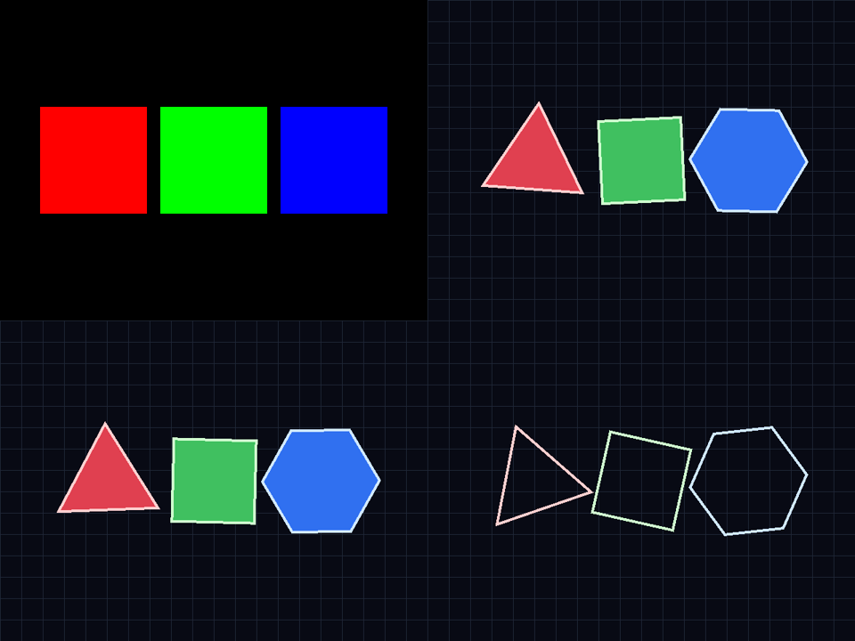

# HW3 VGA 掃描：RGB 色塊與旋轉幾何圖形

## 用途

以 VGA 掃描（640×480@60，R、G、B 各 1 bit）顯示圖形，按 BTNU 切換兩個模式：

- **基本模式**（reset 後）：R、G、B 三個矩形色塊，位置與大小可任意設定，重疊處加色混合
- **旋轉圖形模式**（Bonus）：三角形、正方形、六邊形各自旋轉，每個像素由一條「矩陣 × 向量」
  管線即時判斷，不需要 framebuffer；可調轉速、方向與填色／外框

完整規格與設計理由見 [`SPEC.md`](SPEC.md)。

- 目標板：e-elements EGO-XZ7（`xc7z020clg484-1`，100 MHz），腳位見 `constraints/HW_3.xdc`
- Top 模組：`HW_3`，測試檔：`HW_3_tb`（VHDL 2008）
- 單一時脈域，像素率 100 MHz / 4 = 25 MHz（以時脈致能推進）
- 內部有一組 RGB888 視訊串流（`stream_*`），之後加 HDMI 只要換掉輸出級，見 SPEC §6.4



## 色塊的位置與大小

在 `src/HW_3.vhd` 的 generic（或 Vivado 的 Settings → Generics）修改，單位為像素：

| 色塊 | 左上角 | 寬 × 高 |
|---|---|---|
| R | `R_X`、`R_Y`（60, 160） | `R_W` × `R_H`（160 × 160） |
| G | `G_X`、`G_Y`（240, 160） | `G_W` × `G_H`（160 × 160） |
| B | `B_X`、`B_Y`（420, 160） | `B_W` × `B_H`（160 × 160） |

## 旋轉圖形怎麼算

正 N 邊形 = N 個半平面 `n_k · p ≤ a` 的交集。轉 θ 就是把法向量轉 θ，排成 N×2 矩陣 W：

```text
每幀一次：  W = N0 · R(θ)ᵀ          （矩陣 × 矩陣，垂直遮沒時算）
每個像素：  s = W · (x − CX, y − CY)  （矩陣 × 向量，2N 個 DSP 同時乘）
判斷：      max(s) ≤ a → 形狀內；max(s) > a − 4 → 外框
```

## 架構

| 檔案 | 區段 | 功能 |
|---|---|---|
| `src/HW_3.vhd` | ① 像素致能 | 每 4 個 clk 一拍 `pix_ce` |
| `src/HW_3_timing.vhd` | ② 視訊時序 | 640×480@60 計數器，輸出對齊的 x / y / de / hs / vs |
| `src/HW_3_btn.vhd`、`src/HW_3.vhd` | ③ 按鈕 ×4、SW0、設定 | 去彈跳，保存模式、轉速、方向、樣式 |
| `src/HW_3.vhd` | ④ 角度累加 | 每幀更新三個形狀的角度 |
| `src/HW_3_poly.vhd` | ⑤ 多邊形管線 ×3 | 每幀算 W；每像素 4 級管線：平移 → 乘 → 加 → 門檻 |
| `src/HW_3.vhd` | ⑥ 延遲線 | 座標與同步延遲 4 個像素，對齊 ⑤ |
| `src/HW_3.vhd` | ⑦ 合成 | 基本模式畫色塊、旋轉模式畫格線 + 形狀，輸出 RGB888 串流 |
| `src/HW_3.vhd` | ⑧ VGA 輸出級 | 取每色最高位元、同步負極性 |

## 操作

| 輸入 | 功能 | LED |
|---|---|---|
| BTNC | reset（回到基本模式） | |
| BTNU | 模式：基本色塊 ↔ 旋轉圖形 | LD0 亮 = 旋轉圖形 |
| SW0 | 撥上暫停旋轉 | LD1 亮 = 轉動中 |
| BTNR | 反轉 | LD2 |
| BTNL | 轉速 ×1 → ×2 → ×4 → ×8 | LD4..LD3 |
| BTND | 填色 + 外框 → 只填色 → 只有外框 | LD6..LD5 |

LD7 約 1 Hz 閃爍，表示時序在跑（沒接螢幕也看得到）。

## 模擬

```powershell
.\Manage-FPGA.ps1 create HW3
.\Manage-FPGA.ps1 open HW3
```

在 Vivado 執行 Run Simulation（已設定跑 160 ms，約 1～2 分鐘），Tcl Console 最後應印出
`HW_3_tb PASS`。擷取的畫面存成 PPM，位置在
`vivado/HW3/HW3.sim/sim_1/behav/xsim/`，可用 GIMP、IrfanView 等打開。

## 上板前要補的東西

EGO-XZ7 的 Vivado board file 沒有 VGA 腳位。上板前請：

1. 在 `constraints/HW_3.xdc` 的 TODO 區段填入 `vga_r`、`vga_g`、`vga_b`、`vga_hs`、`vga_vs` 的腳位
2. 每色接約 270 Ω 串聯電阻到 VGA 接頭（螢幕端 75 Ω，得到約 0.7 V）
3. 若改接多位元電阻 DAC，修改 `HW_3` 的 `RED_BITS`、`GREEN_BITS`、`BLUE_BITS`

沒填腳位也能綜合，但 bitstream 會被 DRC 擋下。
