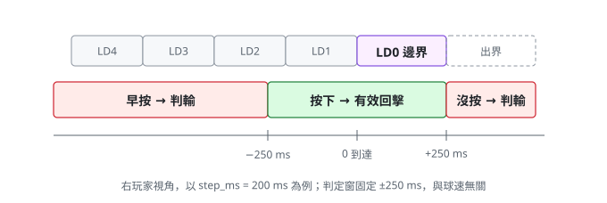
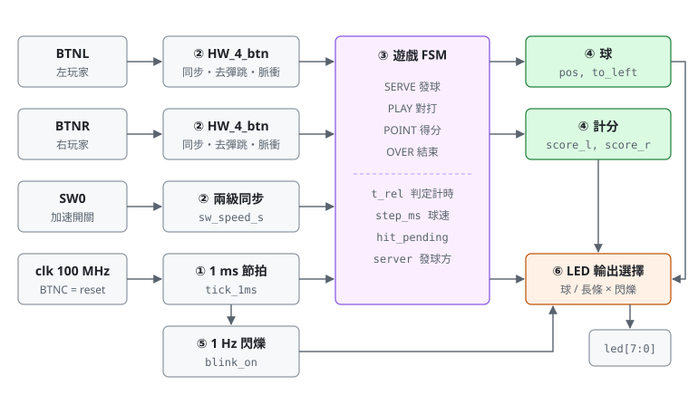
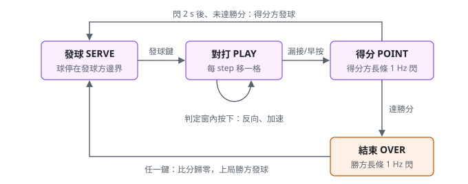

# HW4 LED 乒乓球

## 用途

8 顆 LED 是球桌、BTNL / BTNR 是左右球拍的雙人乒乓球。一顆亮著的 LED 代表球，在 LD7（左）與
LD0（右）之間來回；球抵達自己這端邊界的前後 **±250 ms** 內按下按鈕就把球打回去，太早按或沒按
判輸。每得 1 分以長條顯示得分方分數並 **1 Hz** 閃爍，由得分方發下一球；先到 5 分獲勝。
完整規格與設計理由見 [`SPEC.md`](SPEC.md)。

- 目標板：e-elements EGO-XZ7（`xc7z020clg484-1`，100 MHz），腳位見 `constraints/HW_4.xdc`
- Top 模組：`HW_4`，測試檔：`HW_4_tb`（VHDL 2008）
- 全同步設計、單一時脈域；時間參數皆為 generic，模擬時可縮短

## 怎麼玩

| 輸入 | 功能 |
|---|---|
| BTNL | 左玩家：發球（輪到左方時）、回擊（球往左時） |
| BTNR | 右玩家：發球（輪到右方時）、回擊（球往右時） |
| SW0 | 球速：撥下慢速 500 ms／格、撥上快速 250 ms／格（發球時決定，這一球打完前不變） |
| BTNC | reset：比分歸零、左方發球 |

1. Reset 後 LD7 恆亮：左方按 BTNL 發球，球往右移。
2. 球走到 LD0 前後 250 ms 內右方按 BTNR，球反向往左。太早按（判定窗之前）或球到 LD0 後 250 ms
   還沒按，左方得 1 分。
3. 得分後，得分方那一端亮出長條（亮幾顆 = 幾分），閃 2 秒，接著由得分方發球。
4. 先到 5 分獲勝，勝方長條持續閃爍；任一方按鍵重新開局，由勝方先發。



## 架構



| 編號 | 功能 | 規格章節 |
|---|---|---|
| ① 1 ms 節拍 | 所有遊戲時間的基準 | §7.1 |
| ② 按鈕介面 ×2、SW0 同步 | 同步、20 ms 去彈跳，按下瞬間一個脈衝；按住不會重複 | §8.2 |
| ③ 遊戲 FSM | SERVE / PLAY / POINT / OVER，只負責切換狀態 | §5 |
| ④ 判定 | 一個組合邏輯 process：依 `t_rel` 決定這一拍是發球、回擊、判輸（`foul`）還是推進 | §4.3、§5 |
| ④ 球的暫存器 | `to_left`、`step_ms`、`t_rel`、`hit_pending`、`step_cnt`、`pos`、`lose` 各一個 process | §4、§7.2 |
| ④ 計分 | `score_l`、`score_r` | §4.5 |
| ⑤ 1 Hz 閃爍 | 分數長條閃爍 | §6.2 |
| ⑥ LED 輸出選擇 | 球（one-hot）或分數長條，經暫存器輸出 | §6 |



主要 generic：`STEP_MS_SLOW`、`STEP_MS_FAST`（球速）、`HIT_EARLY_MS`、`HIT_LATE_MS`
（判定窗）、`WIN_SCORE`（勝分，1 ~ 8）、`BLINK_HALF_MS`、`SCORE_SHOW_MS`，預設值見 SPEC §3.1。

## 檔案

| 路徑 | 內容 |
|---|---|
| `SPEC.md` | 設計規格：規則、狀態機、判定計時、LED 顯示、驗證計畫、腳位 |
| `src/HW_4.vhd` | 設計原始碼（Top） |
| `src/HW_4_btn.vhd` | 按鈕介面：同步、去彈跳、按下脈衝（與 HW3 相同） |
| `sim/HW_4_tb.vhd` | 自我檢查測試檔（VHDL 2008），涵蓋 SPEC §10 全部項目；約 0.17 ms 後印出 PASS / FAIL |
| `constraints/HW_4.xdc` | EGO-XZ7 腳位檔 |
| `Create-Project.tcl` | 由本目錄原始碼建立 Vivado 專案（測試檔設為 VHDL 2008） |
| `Import-FromVivado.ps1` | 從舊 Vivado 專案匯入 HW4 檔案 |
| `Run-GHDL.ps1` | 不開 Vivado，用 GHDL 跑 `HW_4_tb` |
| `docs/*.svg` | 架構圖、狀態機、判定窗 |

## 建立與模擬

```powershell
.\Manage-FPGA.ps1 create HW4
.\Manage-FPGA.ps1 open HW4
```

不開 Vivado 時可用 GHDL（`winget install --id ghdl.ghdl.ucrt64.mcode -e`）：

```powershell
.\HW4\Run-GHDL.ps1
```

## 進度與待辦

- [x] 規格（`SPEC.md`）
- [x] 設計原始碼、測試檔（GHDL：`HW_4_tb PASS`）
- [x] Vivado 2018.3 實作：168 LUT、138 FF，WNS +2.9 ns
- [ ] 上板確認 LED 左右順序（LD7 是否在左）
- [ ] 上板試玩，調整球速與判定窗
