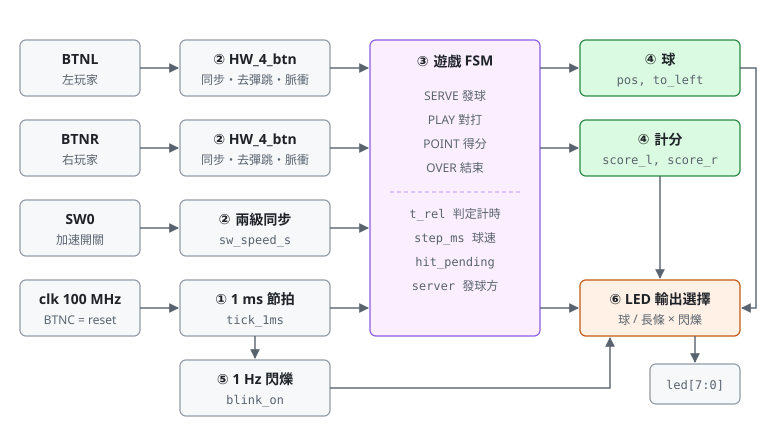
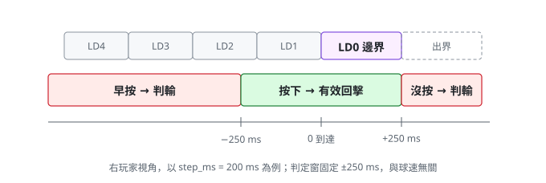
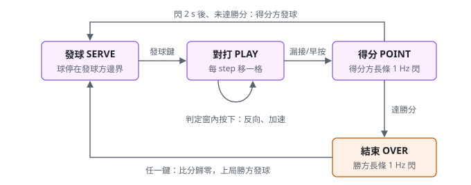

# HW4 LED 乒乓球規格

## 1. 目標

以板上 8 顆 LED 當球桌、左右兩顆按鈕當球拍，做一個雙人乒乓球遊戲：

- 一顆亮著的 LED 代表球，在 LD7（左）與 LD0（右）之間來回移動。
- 球到自己這一端的邊界時按下按鈕，球就反向往對方移動；判定窗為抵達邊界前後各 **±250 ms**。
- 太早按（判定窗之前）或沒按（球超出邊界）都判輸，對方得 1 分。
- 球速兩段，以 SW0 選擇：撥下慢速 **500 ms／格**、撥上快速 **250 ms／格**。
- 每得 1 分，以長條顯示**得分方**目前的分數，並以 **1 Hz** 閃爍；由**得分方**發下一球。
- 先達 `WIN_SCORE` 分者獲勝，勝方長條持續閃爍，按任一鍵重新開局。

設計為全同步電路，只有單一時脈域，所有時間參數皆以 generic 設定，方便在模擬時縮短時間。

- 目標板：e-elements EGO-XZ7（`xc7z020clg484-1`，100 MHz），腳位見 `constraints/HW_4.xdc`
- 語言：VHDL（`ieee.numeric_std`）；設計為 VHDL-93，測試檔需以 VHDL 2008 編譯
- Top 模組：`HW_4`，測試檔：`HW_4_tb`
- 板上沒有七段顯示器，分數只能用這 8 顆 LED 表示（§6）

## 2. 架構



左邊是板上輸入，經同步與去彈跳後變成單拍脈衝；中間的遊戲 FSM 以 1 ms 節拍推進球與判定計時；
右邊依狀態選擇 LED 要顯示球還是分數長條。圖中圓圈編號對應原始碼區段：

| 編號 | 功能 | 檔案 | 主要訊號 | 章節 |
|---|---|---|---|---|
| ① 1 ms 節拍 | 由 `clk` 除頻出 1 ms 單拍致能 | `HW_4.vhd` | `tick_cnt`、`tick_1ms` | §7.1 |
| ② 按鈕介面 ×2、SW0 同步 | 同步、去彈跳、按下瞬間的單拍脈衝；SW0 兩級同步 | `HW_4_btn.vhd`、`HW_4.vhd` | `press_l`、`press_r`、`sw_speed_s` | §8 |
| ③ 遊戲 FSM | 只負責切換狀態、記錄發球方與 POINT 顯示時間 | `HW_4.vhd` | `state`、`server`、`wait_cnt` | §5 |
| ④ 判定 | 組合邏輯 process：依 `t_rel` 決定這一拍是發球、回擊、判輸、先記下還是推進 | `HW_4.vhd` | `serve`、`hit`、`foul`、`pend_set`、`advance` | §4.3、§5 |
| ④ 球的暫存器 | 每個暫存器一個 process，依判定結果更新；輸了送出 `lose` | `HW_4.vhd` | `lose`、`to_left`、`step_ms`、`t_rel`、`hit_pending`、`step_cnt`、`pos` | §4、§7.2 |
| ④ 計分 | 接球方輸時對方加 1 分；重新開局歸零 | `HW_4.vhd` | `score_l`、`score_r` | §4.5 |
| ⑤ 1 Hz 閃爍 | 每 500 ms 翻轉一次，進入 POINT / OVER 時從「亮」開始 | `HW_4.vhd` | `blink_cnt`、`blink_on` | §6.2 |
| ⑥ LED 輸出選擇 | 依狀態輸出球（one-hot）或分數長條，經暫存器輸出 | `HW_4.vhd` | `led_reg` | §6 |

全部 process 由 `clk` 驅動，時序控制一律使用單拍致能脈衝（`tick_1ms`、`press_l`、`press_r`），
不產生衍生時脈。程式只用基本寫法：沒有 function，process 內沒有 variable，每個 process 只管一組暫存器。
回擊判定集中在 ④ 判定這一個組合邏輯 process；球的每個暫存器各有一個小 process，只寫「遇到哪個判定
結果就怎麼改」，不再巢狀 if。③ FSM 與 ④ 計分只看單拍的 `lose`（接球方輸了）。
組合邏輯只有兩個按鍵選擇：`press_rx`（接球方的按鍵）、`press_srv`（發球方的按鍵）。

## 3. 介面

### 3.1 Generic

| 名稱 | 型別 | 預設值 | 說明 |
|---|---|---|---|
| `CLK_FREQ_HZ` | positive | 100_000_000 | 系統時脈頻率；必須是 1000 的倍數 |
| `DEBOUNCE_MS` | positive | 20 | 去彈跳：按鈕需連續穩定的時間 |
| `STEP_MS_SLOW` | positive | 500 | 慢速：球每移一格的時間（SW0 撥下） |
| `STEP_MS_FAST` | positive | 250 | 快速：球每移一格的時間（SW0 撥上） |
| `HIT_EARLY_MS` | natural | 250 | 判定窗：抵達邊界**前**可按的時間 |
| `HIT_LATE_MS` | natural | 250 | 判定窗：抵達邊界**後**可按的時間（球停在邊界等待） |
| `WIN_SCORE` | positive | 5 | 勝分，範圍 1 ~ 8（長條最多 8 顆） |
| `BLINK_HALF_MS` | positive | 500 | 閃爍半週期；500 ms 即 1 Hz |
| `SCORE_SHOW_MS` | positive | 2000 | POINT 狀態顯示分數的時間（閃 2 次） |
| `LED_ACTIVE_LOW` | boolean | false | LED 低電位點亮時設為 true |
| `BTN_ACTIVE_LOW` | boolean | false | 按鈕按下為低電位時設為 true |

內部常數：

- `TICK_DIV = CLK_FREQ_HZ / 1000`：1 ms 節拍的除頻值。
- `DEBOUNCE_CYCLES = DEBOUNCE_MS × TICK_DIV`：傳給 `HW_4_btn`。
- `EDGE_L = 7`、`EDGE_R = 0`：左右邊界的 LED 編號。
- `TRAVEL = 7`：從一端到另一端的步數。

Elaboration 時以 `assert` 檢查：

| 條件 | 理由 |
|---|---|
| `CLK_FREQ_HZ mod 1000 = 0` | 節拍才是整 1 ms |
| `STEP_MS_FAST ≤ STEP_MS_SLOW` | 快速不能比慢速慢 |
| `1 ≤ WIN_SCORE ≤ 8` | 長條只有 8 顆 |
| `HIT_EARLY_MS < TRAVEL × STEP_MS_FAST` | 否則球一發出就在判定窗內，「早按」永遠不會發生 |
| `SCORE_SHOW_MS mod (2 × BLINK_HALF_MS) = 0` | POINT 結束時剛好閃完整數次 |

### 3.2 Port

| 名稱 | 方向 | 寬度 | 說明 |
|---|---|---|---|
| `clk` | in | 1 | 系統時脈 |
| `reset` | in | 1 | 同步、高電位有效（與 HW1 ~ HW3 相同） |
| `btn_l` | in | 1 | 左玩家球拍（BTNL） |
| `btn_r` | in | 1 | 右玩家球拍（BTNR） |
| `sw_speed` | in | 1 | 球速：撥下慢速、撥上快速，發球時取樣（SW0） |
| `led` | out | 8 | `led(k)` 接 LD k，經暫存器輸出 |

## 4. 遊戲規則

### 4.1 座標

```text
 左玩家 BTNL                                     右玩家 BTNR
   LD7   LD6   LD5   LD4   LD3   LD2   LD1   LD0
  pos=7                                        pos=0
  EDGE_L                                       EDGE_R
```

- `pos`（0 ~ 7）：球所在的 LED，`led(pos)` 點亮。
- `to_left`：`'1'` 表示球往左（`pos` 遞增），此時**接球方**是左玩家；`'0'` 表示往右，接球方是右玩家。
  接球方完全由 `to_left` 決定，不需要另外的暫存器。
- 本規格假設 LD7 在板子左側、LD0 在右側；若實際相反，只要對調 `btn_l` / `btn_r` 腳位（§10）。

### 4.2 發球

- `server`：`'1'` = 左玩家發球，`'0'` = 右玩家發球。Reset 後左玩家先發。
- SERVE 狀態下球停在發球方邊界（左發 `pos = 7`、右發 `pos = 0`），恆亮不閃。
- 只有發球方的按鈕有效；另一方按下忽略。
- 發球方按下：`to_left` 設為「往對方」，依 SW0 設定 `step_ms`（§4.4），進入 PLAY 並啟動一趟移動（§7.2）。

### 4.3 回擊判定



以 `t_rel` 表示「距離球抵達接球方邊界的時間」（ms，抵達瞬間為 0，之前為負）。接球方的按鍵依
按下時的 `t_rel` 判定：

| 接球方按下時 | 結果 |
|---|---|
| `t_rel < −HIT_EARLY_MS` | **早按**：接球方判輸 |
| `−HIT_EARLY_MS ≤ t_rel < 0` | 有效：記下 `hit_pending`，球照常走到邊界，抵達瞬間反向 |
| `0 ≤ t_rel ≤ HIT_LATE_MS` | 有效：球停在邊界等待，按下當下立即反向 |
| 到 `t_rel = HIT_LATE_MS` 仍未按 | **出界**：接球方判輸 |

- 判定窗兩端都包含在內：剛好 `t_rel = −HIT_EARLY_MS` 或 `+HIT_LATE_MS` 按下都算有效。
- 已記下 `hit_pending` 後，同一趟再按忽略。
- 非接球方（剛擊球、球正遠離的一方）按下一律忽略。
- 無論早接或晚接，反向後球都在邊界再停一個 `step_ms` 才離開，回程的樣子不受按下時機影響。
- 判定窗是固定時間，與球速無關（以時間判定，而不是以「球在哪一格」判定）。預設值下，快速時判定窗
  在球進入邊界前一格（LD1 / LD6）的瞬間打開；慢速時在球到前一格的一半才打開。

### 4.4 球速

| SW0 | `step_ms` | 一趟 7 格 |
|---|---|---|
| 撥下 | `STEP_MS_SLOW`（500 ms） | 3.5 s |
| 撥上 | `STEP_MS_FAST`（250 ms） | 1.75 s |

- **只在發球時取樣 SW0**，之後回擊都不改球速；對打中撥動 SW0，從下一次發球才生效。
- `step_ms` 一球之內固定，所以 `t_rel` 與 `pos` 永遠一致（§7.2）。

### 4.5 計分與勝負

- 早按或出界時，**非接球方**得 1 分：`score_x ← score_x + 1`，並設 `server ← 得分方`。
- `score_l`、`score_r` 範圍 0 ~ `WIN_SCORE`（4 bit）。
- 進入 POINT 後顯示得分方長條 `SCORE_SHOW_MS`；結束時：
  - 得分方分數 = `WIN_SCORE` → OVER；
  - 否則 → SERVE，由得分方發球。
- OVER 狀態按任一顆按鈕：兩邊分數歸零，進入 SERVE，`server` 不變（上一局勝方先發）。

## 5. 狀態機



| 狀態 | LED 顯示 | 有效輸入 | 離開條件 |
|---|---|---|---|
| `SERVE` | 球恆亮在發球方邊界 | 發球方按鈕 | 發球方按下 → `PLAY` |
| `PLAY` | 球（one-hot `pos`） | 接球方按鈕 | 有效回擊 → 留在 `PLAY`；早按或出界 → `POINT` |
| `POINT` | 得分方長條，1 Hz 閃 | 無（按鈕忽略） | `wait_cnt` 滿 `SCORE_SHOW_MS` → `OVER` 或 `SERVE` |
| `OVER` | 勝方長條，1 Hz 閃 | 任一按鈕 | 按下 → `SERVE`，比分歸零 |

`PLAY` 中的判定寫在 ④ 判定（組合邏輯 process），`press_rx` 為接球方的按鍵，每個 clk 依序檢查：

```text
if press_rx 且 −HIT_EARLY_MS ≤ t_rel < 0      → pend_set（另外獨立判斷，可與 advance 同一拍）

if    press_rx 且 t_rel < −HIT_EARLY_MS           → foul（早按）
elsif (press_rx 或 hit_pending) 且 t_rel ≥ 0     → hit（回擊；早接在抵達的下一拍生效）
elsif tick_1ms 且 t_rel = HIT_LATE_MS            → foul（出界）
elsif tick_1ms                                   → advance（推進）
```

`SERVE` 中發球方按下則 `serve`。球的暫存器各自依這些結果更新：

| 暫存器 | `serve` | `hit` | `advance` | 其他 |
|---|---|---|---|---|
| `to_left` | 往對方（`not server`） | 反向 | — | — |
| `step_ms` | SW0 選的球速 | — | — | — |
| `t_rel` | −7 × 新球速 | −7 × `step_ms` | 加 1 | — |
| `hit_pending` | 清除 | 清除 | — | `pend_set` 時設 1 |
| `step_cnt` | 清除 | 清除 | 球不在邊界時加 1，到 `step_ms − 1` 歸零（`move`） | — |
| `pos` | — | — | `move` 時移一格 | 非 `PLAY` 時放到 `server` 那一端 |
| `lose` | — | — | — | 每拍 = 上一拍的 `foul` |

- `lose` 是暫存器輸出的單拍脈衝，③ FSM 與 ④ 計分在下一個 clk 才看到，所以得分比判定晚 1 clk（10 ns）。
  這一拍 `state` 仍是 `PLAY`，④ 判定以 `lose = '0'` 為條件，不會再判定或推進。
- `SERVE`、`POINT`、`OVER` 中 `pos` 放到 `server` 那一端：`POINT` / `OVER` 時 `server` 已是
  得分方 / 勝方，也就是下一個發球方，所以回到 `SERVE` 的第一拍球就在正確位置。

## 6. LED 顯示

### 6.1 長條

分數 `s` 以「從得分方那一端往中間亮 `s` 顆」表示，因此看長條從哪一端長出來就知道是誰得分：

| 得分方 | 分數 | LD7 … LD0 |
|---|---|---|
| 左 | 1 | `●○○○○○○○` |
| 左 | 3 | `●●●○○○○○` |
| 右 | 2 | `○○○○○○●●` |
| 右 | 5 | `○○○●●●●●` |

程式中以兩張查表 `BAR_L(0 .. 8)`、`BAR_R(0 .. 8)` 直接列出 9 種圖樣，`BAR_L(score_l)` 即左玩家長條。

POINT 只顯示得分方的分數，另一方的分數不顯示。

### 6.2 1 Hz 閃爍

- `blink_cnt` 每個 `tick_1ms` 加 1，到 `BLINK_HALF_MS − 1` 歸零並翻轉 `blink_on`。
- `SERVE`、`PLAY` 中 `blink_cnt` 保持 0、`blink_on` 保持 `'1'`，所以進入 `POINT` 時一定從「亮」開始。
- `SCORE_SHOW_MS` 是整數個閃爍週期（§3.1 的 assert），`POINT` 結束時 `blink_on` 剛好回到 `'1'`、
  `blink_cnt` 回到 0，因此進入 `OVER` 時也從「亮」開始，不需要另外清除。
- 輸出 = 長條 AND `blink_on`；預設 0.5 s 亮、0.5 s 暗。

### 6.3 輸出

`led_reg` 依狀態選擇：`SERVE` / `PLAY` 為 one-hot(`pos`)，`POINT` / `OVER` 為長條（`blink_on = '0'` 時全暗），
經暫存器輸出避免組合邏輯毛刺；`LED_ACTIVE_LOW = true` 時輸出端再整個反相。

## 7. 計時

### 7.1 1 ms 節拍（①）

`tick_cnt` 從 0 數到 `TICK_DIV − 1`，歸零那一拍輸出 `tick_1ms = '1'`。遊戲中所有時間（球速、
判定窗、閃爍、POINT 長度）都以 `tick_1ms` 計數，模擬時改小 `CLK_FREQ_HZ` 即可整體縮短。

### 7.2 一趟移動與 `t_rel`

每次發球或反向稱為「發出一趟」，在發出的那一拍：

```text
step_cnt    ← 0
t_rel       ← −TRAVEL × step_ms      -- 例：慢速 −7 × 500 = −3500
hit_pending ← '0'
```

之後在 `PLAY` 中每個 `tick_1ms`：

```text
t_rel ← t_rel + 1
if pos ≠ 接球方邊界 then
    if step_cnt = step_ms − 1 then step_cnt ← 0; pos 往 to_left 方向移一格
    else step_cnt ← step_cnt + 1
```

經過 `7 × step_ms` 個 tick 後，`pos` 剛好走到邊界且 `t_rel` 剛好為 0，兩者由同一個 tick 推進，
不會錯開。到達邊界後 `pos` 不再移動，`t_rel` 繼續加到 `HIT_LATE_MS` 為止。

位寬：`t_rel` 範圍 −`TRAVEL × STEP_MS_SLOW` ~ `HIT_LATE_MS`（預設 −3500 ~ 250，13 bit 有號）；
`step_cnt` 範圍 0 ~ `STEP_MS_SLOW − 1`（9 bit）；`wait_cnt` 0 ~ `SCORE_SHOW_MS − 1`（11 bit）。

### 7.3 誤差

- 發出一趟發生在任意 clk，不一定對齊 tick，第一個 tick 可能不到 1 ms 就來，誤差 < 1 ms。
- 去彈跳使按鍵脈衝比實際按下晚 `DEBOUNCE_MS`（20 ms）：脈衝落在 −250 ~ +250 ms 內，代表手指是在
  −270 ~ +230 ms 之間按下的，判定窗整體往前移了 20 ms。需要以手指時間完全對稱時，可把
  `HIT_EARLY_MS` 減、`HIT_LATE_MS` 加 `DEBOUNCE_MS`；目前不補償。

## 8. 按鈕與開關

### 8.1 操作對照

| 輸入 | SERVE | PLAY | POINT | OVER |
|---|---|---|---|---|
| BTNL | 左發球時發球 | 球往左時回擊 | 忽略 | 重新開局 |
| BTNR | 右發球時發球 | 球往右時回擊 | 忽略 | 重新開局 |
| SW0 | 發球瞬間取樣：撥下慢速、撥上快速 | — | — | — |
| BTNC | reset（任何狀態） | | | |

### 8.2 按鈕訊號處理（②）

`HW_4_btn` 沿用 `HW3/src/HW_3_btn.vhd` 的電路（只改實體名稱）：

1. **極性與同步**：依 `BTN_ACTIVE_LOW` 反相後經兩級正反器。
2. **去彈跳**：同步後的值與 `stable` 不同時開始計數，連續 `DEBOUNCE_CYCLES` 個 clk 不同才更新
   `stable`；中途變回來就重數。
3. **按下脈衝**：`stable` 由 0 變 1 的那一拍輸出 `press = '1'`；放開不觸發，按住不重複。

一直按住按鈕只會產生一個脈衝，所以「按住不放」無法通過判定窗，必須抓時機按。

SW0 是電位而非動作，只經兩級同步成 `sw_speed_s`，不需去彈跳：它只在發球瞬間被取樣一次，
撥動時的彈跳最多讓那一球是快速或慢速。

## 9. Reset 行為

`reset = '1'` 時：`state = SERVE`、`server = '1'`（左發）、`pos = 7`、`score_l = score_r = 0`、
`step_ms = STEP_MS_SLOW`、`hit_pending = '0'`，所有計數器歸零，`blink_on = '1'`；
LED 輸出為 reset 後第一拍的 SERVE 畫面（LD7 亮）。按鈕介面的 `stable` 清為 0。

## 10. 驗證計畫（`HW_4_tb`）

模擬時覆寫 generic 以縮短時間：`CLK_FREQ_HZ = 10_000`（1 ms = 10 clk）、`DEBOUNCE_MS = 2`、
`STEP_MS_SLOW = 20`、`STEP_MS_FAST = 10`、`HIT_EARLY_MS = 10`、`HIT_LATE_MS = 10`、
`BLINK_HALF_MS = 5`、`SCORE_SHOW_MS = 20`、`WIN_SCORE = 3`。

- 測試檔以「球抵達邊界的時刻」為基準，換算 `DEBOUNCE_MS` 延遲後在指定的 `t_rel` 按下按鈕。
- `state`、`t_rel`、`step_ms` 等內部訊號以 VHDL-2008 external name 讀取，因此測試檔需以 VHDL 2008 編譯。
- 同時例化高電位有效版與 `LED_ACTIVE_LOW = BTN_ACTIVE_LOW = true` 版，比對極性。
- 跑完印出 PASS / FAIL。

| 項目 | 檢查方式 |
|---|---|
| Reset | reset 後 LD7 恆亮、比分 0:0、`server` = 左 |
| 只有發球方能發球 | SERVE 中按 BTNR，LED 不變；按 BTNL 才開始移動 |
| 移動 | 球每 `step_ms` 移一格，`led` 永遠 one-hot，依序 LD7 → LD0 |
| 一趟時間 | 發球到 LD0 亮共 `7 × step_ms` ms，且此刻 `t_rel = 0` |
| 晚接邊界 | `t_rel = +HIT_LATE_MS` 按下：反向，球回到 LD7 |
| 早接邊界 | `t_rel = −HIT_EARLY_MS` 按下：球仍走到 LD0 才反向 |
| 早按 | `t_rel = −HIT_EARLY_MS − 1` 按下：立即進入 POINT，對方得分 |
| 出界 | 不按：`t_rel = HIT_LATE_MS` 那一拍進入 POINT，對方得分 |
| 非接球方按鍵 | 球遠離時按下，不影響球與比分 |
| 慢速 | SW0 撥下發球：`step_ms = STEP_MS_SLOW`，每格 `STEP_MS_SLOW` ms |
| 快速 | SW0 撥上發球：`step_ms = STEP_MS_FAST`，每格 `STEP_MS_FAST` ms |
| 對打中撥 SW0 | 回擊後 `step_ms` 不變；下一次發球才換速 |
| 長條 | POINT 中亮燈圖樣 = 得分方長條（§6.1），左右各測一次 |
| 閃爍 | POINT 中長條亮 `BLINK_HALF_MS`、暗 `BLINK_HALF_MS`，從亮開始，共 `SCORE_SHOW_MS` |
| POINT 忽略按鍵 | POINT 中按任一鍵不影響狀態 |
| 得分方發球 | POINT 結束後 SERVE，球停在得分方邊界，只有得分方能發球 |
| 勝負 | 一方達 `WIN_SCORE` 後進入 OVER，勝方長條持續閃爍 |
| 重新開局 | OVER 中按鍵：比分歸零，勝方發球 |
| 去彈跳 | 按鈕加入短於 `DEBOUNCE_MS` 的抖動，不產生按鍵 |
| 按住不放 | 判定窗打開前就按住不放：判早按；之後一直按住也不會再產生按鍵 |
| 極性 | `LED_ACTIVE_LOW = true` 時輸出反相，兩版行為相同 |

## 11. 腳位（EGO-XZ7）

`constraints/HW_4.xdc`，腳位與電壓取自 Vivado 內建 board file（`EGO-XZ7/1.1/part0_pins.xml`）。
板上按鈕按下為高電位、LED 高電位點亮，所以 `BTN_ACTIVE_LOW`、`LED_ACTIVE_LOW` 都維持 `false`。

| Port | 板上元件 | 腳位 | IOSTANDARD |
|---|---|---|---|
| `clk` | System clock 100 MHz | Y9 | LVCMOS33 |
| `reset` | BTNC（中） | P16 | LVCMOS25 |
| `btn_l` | BTNL（左） | N15 | LVCMOS25 |
| `btn_r` | BTNR（右） | R18 | LVCMOS25 |
| `sw_speed` | SW0 | F22 | LVCMOS25 |
| `led(0)` ~ `led(7)` | LD0 ~ LD7 | T22 / T21 / U22 / U21 / V22 / W22 / U19 / U14 | LVCMOS33 |

按鈕、開關與 LED 對時脈非同步，不做 I/O 時序分析（`set_false_path`）。

實作結果（Vivado 2018.3）：168 LUT、138 FF，100 MHz 下 WNS ≈ +2.9 ns，沒有 latch。

## 12. 待確認

| 項目 | 目前規格 | 說明 |
|---|---|---|
| LED 左右順序 | LD7 在左、LD0 在右 | 上板確認；相反時對調 `btn_l` / `btn_r` 腳位 |
| 早按 | 判輸 | 若改成忽略，按鈕亂按也不會輸 |
| 球速 | SW0 二選一：500 / 250 ms，發球時取樣 | 也可改成對打中逐次加速，或判定窗隨球速縮小 |
| 勝分 | `WIN_SCORE = 5` | 範圍 1 ~ 8 |
| 失分方分數 | POINT 不顯示 | 需要時可在另一端以暗亮度（PWM）顯示 |
