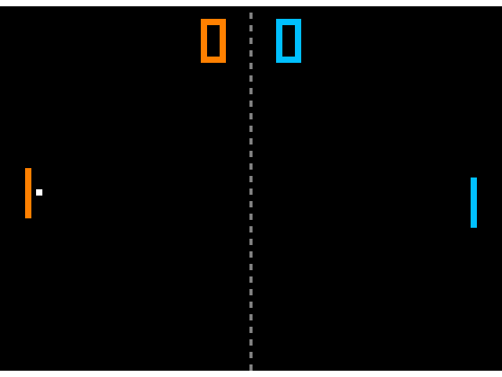
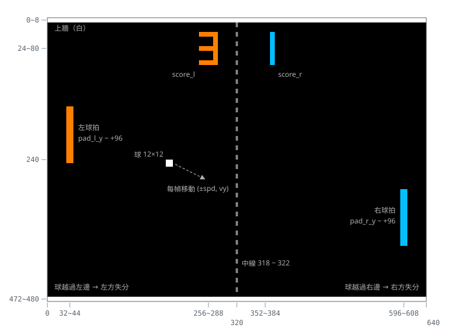
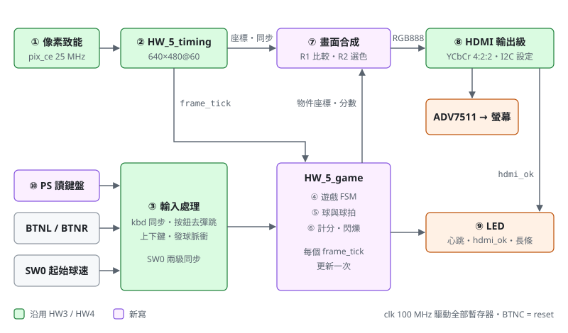
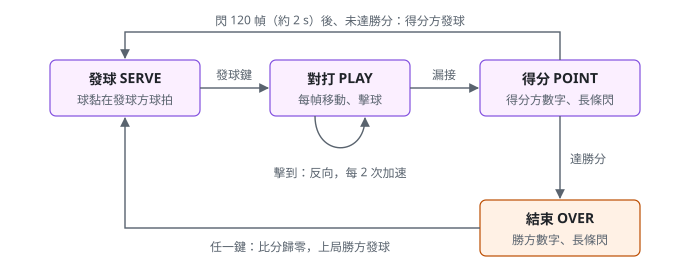
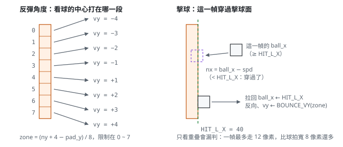

# HW5 HDMI 乒乓球

## 用途

HW4 的雙人乒乓球搬到螢幕上：畫面從板上的 HDMI 輸出（640×480@60），經典 Pong 的玩法，**用 USB 鍵盤控制**。
左方 W / S、右方 ↑ / ↓ 按住移動球拍，放開就停；球（12 × 12）碰到上下牆反彈，碰到球拍（12 × 96）依打在
哪一段決定反彈角度，越過畫面左右邊就失分。分數以七段數字畫在畫面上方，先到 5 分獲勝。
完整規格與設計理由見 [`SPEC.md`](SPEC.md)。

- 目標板：e-elements EGO-XZ7（`xc7z020clg484-1`，100 MHz），腳位見 `constraints/HW_5.xdc`
- Top 模組：`HW_5` = PS block design（讀 USB 鍵盤）+ PL 部分 `HW_5_pong`（遊戲與畫面）
- 測試檔：`HW_5_tb`（PL 整體）、`HW_5_game_tb`（遊戲邏輯），皆為 VHDL 2008
- PL 單一時脈域；像素以 `pix_ce`（25 MHz）推進，遊戲每幀（約 16.8 ms）在垂直遮沒期間更新一次
- 不用 framebuffer：每個像素直接比對球、球拍、牆、中線、數字這些矩形
- HDMI 輸出級與 ADV7511 設定沿用 HW3（YCbCr 4:2:2）
- USB 鍵盤：J2 接在 Zynq PS 的 USB0，PL 碰不到，所以 PS 跑一個裸機 USB host 程式（`sw/usb_kbd`）讀鍵盤，
  經 AXI GPIO 把按鍵狀態交給 PL（SPEC §12）。J2 的 4 個孔後面是板上的 GL850A hub，程式會先設定 hub，
  鍵盤插哪個孔都可以



`HW_5_tb` 擷取的 RGB888 串流：左方剛發球，球離開左球拍。

## 怎麼玩

| 輸入 | 功能 |
|---|---|
| W / S | 左球拍往上 / 往下（按住才動，放開就停） |
| D | 左方發球；比賽結束後重新開局 |
| ↑ / ↓ | 右球拍往上 / 往下 |
| ← | 右方發球；比賽結束後重新開局 |
| BTNL / BTNR | 和 D / ← 相同（沒接鍵盤也能發球） |
| SW0 | 起始球速：撥下慢（4 像素／幀）、撥上快（6 像素／幀），發球時決定 |
| BTNC | reset：比分歸零、左方發球（只重設 PL，鍵盤不用重插） |

1. Reset 後球黏在左球拍上，左方可以先用 W / S 移好位置，再按 D 發球。
2. 把球接回去：打在球拍上半段往上彈、下半段往下彈，越靠邊角度越大。
3. 每回擊 2 次球速加快一階，最快 12 像素／幀（約 0.76 s 跨過球場）。
4. 球越過自己這一邊就失分。得分方的數字與 LED 長條閃 2 秒，接著由得分方發球。
5. 先到 5 分獲勝，勝方數字持續閃爍；任一方按發球鍵重新開局，由勝方先發。



| LED | SERVE / PLAY | POINT / OVER |
|---|---|---|
| LD0 | SW0（亮 = 快速發球） | 得分方的分數長條，1 Hz 閃（同 HW4） |
| LD1 | USB 鍵盤已連線 | |
| LD2 | PS 程式心跳（每 250 ms 翻轉） | |
| LD6 | ADV7511 設定成功 | |
| LD7 | PL 心跳（約 1 Hz） | |

## 上板

1. 板子設定：USB 旁的 **S11** 與 **JP11** 都撥到 **HOST / OTG**（《EGO-XZ7 硬體手冊》V1.2 圖 17），J2 才會供電給鍵盤。
2. 建置（在儲存庫根目錄）：

   ```powershell
   .\Manage-FPGA.ps1 create HW5
   C:\Xilinx\Vivado\2018.3\bin\vivado.bat -mode batch -source HW5/Build-Hardware.tcl
   C:\Xilinx\SDK\2018.3\bin\xsct.bat HW5/sw/Build-Software.tcl
   ```

   產生 `vivado/HW5/sdk/BOOT.bin`（FSBL + bitstream + `usb_kbd`）。
3. 開機，二選一：
   - **SD 卡**：`BOOT.bin` 複製到 FAT32 SD 卡根目錄，開機模式跳線設成 SD，上電。
   - **JTAG**：開機模式設成 JTAG，執行 `C:\Xilinx\SDK\2018.3\bin\xsct.bat HW5/sw/Run-JTAG.tcl`。
4. 開 UART1 看 PS 的訊息：PHY ID、hub 與鍵盤的列舉過程、每次按鍵變化。UART1 和 JTAG 是同一條 micro-USB
   （FTDI 的第二個通道，Windows 上是 `USB Serial Port (COMn)`），用 MobaXterm 等終端機開 Serial、115200、
   Flow control 設 None；只看不用打字。LD2 閃表示 PS 程式在跑；鍵盤插進 J2 任一孔、列舉完成後 LD1 亮。

xsct 回報 `DR shift through all zeroes`（JTAG 鏈上看不到晶片）時，通常是板子還沒上電，或剛重插 USB 線：
確認 S1 打開、電源燈亮，等幾秒再跑一次。

只用 Vivado 燒 bitstream（不跑 PS 程式）時畫面照常輸出，但球拍不會動；BTNL / BTNR 仍可發球。

## 架構



| 編號 | 功能 | 檔案 | 規格章節 |
|---|---|---|---|
| ① 像素致能 | 每 4 個 clk 一拍 `pix_ce` | `src/HW_5_pong.vhd` | §9 |
| ② 視訊時序 | 640×480@60 計數器，`frame_tick` 標出每幀的遮沒開始（沿用 HW3） | `src/HW_5_timing.vhd` | §9 |
| ③ 鍵盤、按鈕、SW0 | `kbd` 同步、發球鍵取上升緣；按鈕去彈跳 | `src/HW_5_pong.vhd`、`src/HW_5_btn.vhd` | §11 |
| ④ 遊戲 FSM | SERVE / PLAY / POINT / OVER；發球鍵事件鎖存到下一幀處理 | `src/HW_5_game.vhd` | §6、§7 |
| ⑤ 球與球拍 | 每幀移動、撞牆、穿過擊球面判定擊球、失分 | `src/HW_5_game.vhd` | §5、§7 |
| ⑥ 計分與閃爍 | 比分、1 Hz 閃爍 | `src/HW_5_game.vhd` | §5.6、§10 |
| ⑦ 畫面合成 | R1 每個物件一個比較、R2 依疊放順序選顏色 | `src/HW_5_pong.vhd` | §4、§8 |
| ⑧ HDMI 輸出級 | RGB → YCbCr 4:2:2、IOB 暫存器、像素時脈；I2C 設定 ADV7511（沿用 HW3） | `src/HW_5_pong.vhd`、`src/HW_5_hdmi_cfg.vhd` | §9 |
| ⑨ LED | 心跳、鍵盤與 HDMI 狀態、分數長條 | `src/HW_5_pong.vhd` | §10 |
| ⑩ PS：USB 鍵盤 | 裸機 USB host 讀鍵盤，寫進 AXI GPIO | `src/HW_5.vhd`、`bd/HW_5_ps.tcl`、`sw/usb_kbd/` | §12 |





主要 generic（在 `HW_5_pong`）：`PADDLE_SPEED`（球拍速度）、`VX_SLOW`、`VX_FAST`、`VX_STEP`、`VX_MAX`、
`SPEEDUP_HITS`（球速與加速）、`WIN_SCORE`（勝分，1 ~ 8）、`BLINK_HALF_FRAMES`、`SCORE_SHOW_FRAMES`，
預設值見 SPEC §3.1。

## 檔案

| 路徑 | 內容 |
|---|---|
| `SPEC.md` | 設計規格：畫面配置、遊戲規則、狀態機、每幀更新、畫面合成、USB 鍵盤、驗證計畫、腳位 |
| `src/HW_5.vhd` | Top：PS block design 的 wrapper + `HW_5_pong` |
| `src/HW_5_pong.vhd` | PL 部分：像素致能、鍵盤與按鈕、畫面合成、HDMI 輸出級、LED |
| `src/HW_5_game.vhd` | 遊戲邏輯：狀態機、球與球拍、計分、閃爍 |
| `src/HW_5_btn.vhd` | 按鈕介面（HW4 的版本多一個 `held` 輸出） |
| `src/HW_5_timing.vhd` | 視訊時序（與 HW3 相同） |
| `src/HW_5_hdmi_cfg.vhd` | ADV7511 I2C 設定（與 HW3 相同） |
| `bd/HW_5_ps.tcl` | 產生 block design：PS7（EGO-XZ7 preset）+ AXI GPIO |
| `sw/usb_kbd/src/` | PS 裸機程式：`usbh.c` 精簡 USB host、`main.c` 按鍵對應與 GPIO |
| `sim/HW_5_game_tb.vhd` | 遊戲邏輯測試檔：內含參考模型，自動對打 30000 幀逐幀比對 |
| `sim/HW_5_tb.vhd` | PL 整體測試檔：3 幀畫面逐像素比對參考畫面、鍵盤輸入、HDMI 輸出、同步時序、ADV7511 設定 |
| `constraints/HW_5.xdc` | EGO-XZ7 腳位檔（HDMI 腳位同 HW3；PS 腳位由 PS7 IP 決定） |
| `Create-Project.tcl` | 由本目錄原始碼建立 Vivado 專案（含 block design，測試檔設為 VHDL 2008） |
| `Build-Hardware.tcl` | 合成、實作、bitstream，匯出 `vivado/HW5/HW_5.hdf` |
| `sw/Build-Software.tcl` | xsct：建 BSP、`usb_kbd`、FSBL，包出 `BOOT.bin` |
| `sw/Run-JTAG.tcl` | xsct：經 JTAG 燒 bitstream、載入並執行 `usb_kbd` |
| `Import-FromVivado.ps1` | 從舊 Vivado 專案匯入 HW5 檔案 |
| `docs/` | 架構圖、畫面配置、擊球判定、狀態機、模擬畫面 |

## 模擬

```powershell
.\Manage-FPGA.ps1 create HW5
.\Manage-FPGA.ps1 open HW5
```

在 Vivado 按 Run Simulation 跑 `HW_5_tb`（約 30 ms 模擬時間，畫面存成 `frame_serve.ppm`、
`frame_play.ppm`，在 `vivado/HW5/HW5.sim/sim_1/behav/xsim/`）。要跑遊戲邏輯測試檔時，在 Sources 視窗的
Simulation Sources 對 `HW_5_game_tb` 按右鍵 → Set as Top（約 1.2 ms 模擬時間）。兩個測試檔最後都印出
PASS / FAIL。PS 與 USB 鍵盤不在模擬範圍內，測試檔直接給 `kbd`。

## 進度與待辦

- [x] 規格（`SPEC.md`）
- [x] 設計原始碼、測試檔（xsim 2018.3：`HW_5_game_tb PASS`、`HW_5_tb PASS`）
- [x] Vivado 2018.3 實作（含 PS）：1193 LUT、862 FF，沒有 DSP、BRAM；WNS +0.30 ns、WHS +0.03 ns，bitstream 產生成功
- [x] PS 程式與 `BOOT.bin` 用 SDK 2018.3 編譯成功
- [x] 上板（JTAG）：bitstream、PS 程式執行，UART1 看到 USB3320 PHY ID、J2 後面的 GL850A hub（`05E3:0608`）列舉成功
- [x] 加上 hub 支援（hub 設定、埠電源與 reset、split transaction、periodic schedule），已編譯並載入板子
- [ ] 上板：確認經 hub 的鍵盤列舉（看 UART1 的 `keyboard ready on hub port N`）、按鍵反應
- [ ] 上板試玩：調整 `PADDLE_SPEED`、加速幅度、確認顏色
