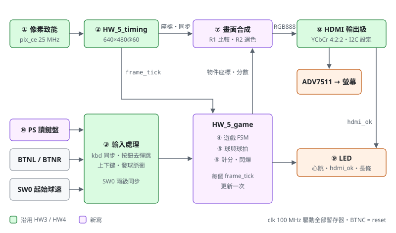
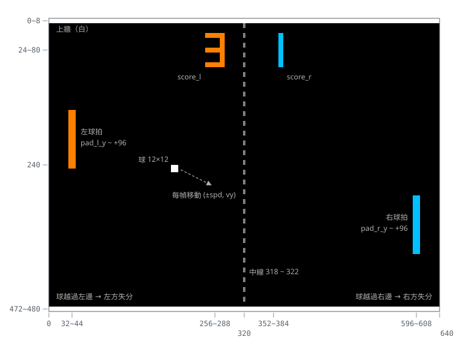
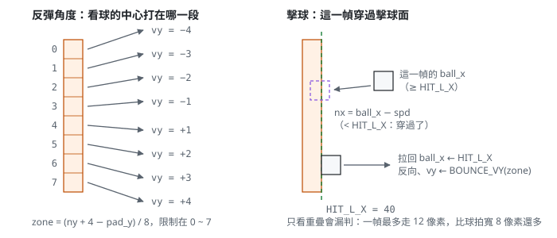
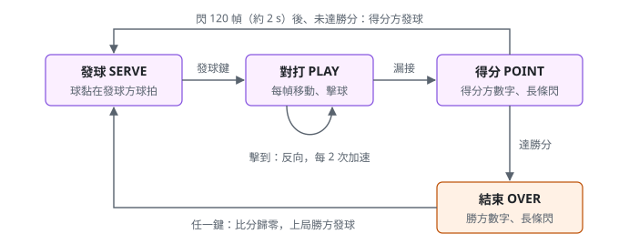

# HW5 HDMI 乒乓球規格

## 1. 目標

把 HW4 的雙人乒乓球搬到螢幕上，畫面從板上的 HDMI 輸出（640×480@60）：

- 經典 Pong：球在 2D 球場裡移動，碰到上下牆反彈，左右兩端各有一支球拍。
- **單鍵球拍**：左玩家 BTNL、右玩家 BTNR，**按住球拍往上、放開往下**。
- 球碰到球拍就反彈，反彈角度由打在球拍的哪一段決定：打在邊緣角度大，打在中間角度小。
- 球越過自己這一端的邊界就失分，對方得 1 分，由**得分方**發下一球。
- 球速：發球時以 SW0 選起始速度（撥下慢、撥上快），對打中每回擊 `SPEEDUP_HITS` 次加速一階，有上限。
- 分數以七段數字畫在螢幕上方；得分時得分方的數字以 1 Hz 閃爍，LED 也照 HW4 閃長條。
- 先達 `WIN_SCORE` 分者獲勝，任一鍵重新開局。

畫面不使用 framebuffer：和 HW3 的基本模式一樣，每個像素直接拿座標比對球、球拍、牆、中線與數字這些矩形。
遊戲狀態只在每幀的垂直遮沒期間更新一次，整幀畫面看到的位置都相同，不會撕裂。

- 目標板：e-elements EGO-XZ7（`xc7z020clg484-1`，100 MHz），腳位見 `constraints/HW_5.xdc`
- 語言：VHDL（`ieee.numeric_std`）；設計為 VHDL-93，測試檔需以 VHDL 2008 編譯
- Top 模組：`HW_5`，測試檔：`HW_5_tb`（整體）、`HW_5_game_tb`（遊戲邏輯）
- 單一時脈域（100 MHz），像素以時脈致能 `pix_ce` 推進，遊戲以幀節拍 `frame_tick` 推進，不產生衍生時脈
- 沿用：HW3 的視訊時序、HDMI 輸出級與 ADV7511 設定（已上板確認顏色正確）；HW4 的按鈕介面、狀態機骨架、
  計分與 LED 長條

## 2. 架構



上排是視訊路徑：時序產生器掃出座標，畫面合成逐像素判斷要畫什麼顏色，再經 HDMI 輸出級送給 ADV7511。
下排是遊戲路徑：按鈕經去彈跳後送進遊戲邏輯，遊戲邏輯在每幀的 `frame_tick` 更新一次球、球拍與分數，
把物件座標交給畫面合成。兩條路徑只在「物件座標」交會，而座標只在遮沒期間改變。

| 編號 | 功能 | 檔案 | 主要訊號 | 章節 |
|---|---|---|---|---|
| ① 像素致能 | 每 `PIX_DIV` 個 clk 一拍 | `HW_5.vhd` | `div_cnt`、`pix_ce` | §9 |
| ② 視訊時序 | 640×480@60 計數器，輸出對齊的座標與同步；`frame_start` 與 `pix_ce` 取 AND 成 `frame_tick`，標出每幀的遮沒開始 | `HW_5_timing.vhd`、`HW_5.vhd` | `x`、`y`、`de`、`hs`、`vs`、`frame_tick` | §7.1、§9 |
| ③ 按鈕 ×2、SW0 同步 | 同步、去彈跳；輸出按下脈衝與目前是否按住 | `HW_5_btn.vhd`、`HW_5.vhd` | `press_l/r`、`held_l/r`、`sw_speed_s` | §11 |
| ④ 遊戲 FSM | SERVE / PLAY / POINT / OVER；按鍵事件鎖存到下一個 `frame_tick` 才處理 | `HW_5_game.vhd` | `state`、`server`、`req_l/r`、`wait_cnt` | §6、§7 |
| ⑤ 球與球拍 | 每幀移動球拍與球，判斷撞牆、擊球、失分 | `HW_5_game.vhd` | `pad_l_y`、`pad_r_y`、`ball_x`、`ball_y`、`to_left`、`spd`、`vy` | §5、§7 |
| ⑥ 計分與閃爍 | 失分方的對手加 1 分；POINT / OVER 時 1 Hz 閃爍 | `HW_5_game.vhd` | `score_l`、`score_r`、`blink_on` | §5.6、§10 |
| ⑦ 畫面合成 | 兩級管線：先算每個物件是否蓋到這個像素，再依優先順序選顏色 | `HW_5.vhd` | `hit_*`、`stream_rgb`、`stream_de/hs/vs` | §4、§8 |
| ⑧ HDMI 輸出級 | RGB → YCbCr 4:2:2、IOB 暫存器、像素時脈；I2C 設定 ADV7511 | `HW_5.vhd`、`HW_5_hdmi_cfg.vhd` | `hd_reg`、`hclk_reg`、`hdmi_ok` | §9 |
| ⑨ LED | SERVE / PLAY 顯示 HDMI 狀態與心跳；POINT / OVER 閃得分方長條 | `HW_5.vhd` | `led_reg` | §10 |

遊戲邏輯 ④⑤⑥ 獨立成 `HW_5_game` 一個 entity，輸入只有 `frame_tick`、按鍵與 SW0，輸出是物件座標與
分數。這樣 `HW_5_game_tb` 可以每幾個 clk 就送一個 `frame_tick`，不必真的掃完一幀（一幀要 168 萬個 clk，
見 §13）。

沿用的檔案只改實體名稱，電路不變：

| 新檔案 | 來源 | 改動 |
|---|---|---|
| `HW_5_timing.vhd` | `HW3/src/HW_3_timing.vhd` | 只改名稱 |
| `HW_5_hdmi_cfg.vhd` | `HW3/src/HW_3_hdmi_cfg.vhd` | 只改名稱 |
| `HW_5_btn.vhd` | `HW4/src/HW_4_btn.vhd` | 多一個輸出 `held`（= 去彈跳後的 `stable`），單鍵球拍要知道按鈕是否按住 |
| `HW_5.vhd` 的 ①、⑧ | `HW3/src/HW_3.vhd` 的 ①、⑨ | 電路相同，改成不用 function 與 variable 的寫法；輸入改接 ⑦ 的 `stream_*` |

程式風格照 HW4：沒有 function，process 內沒有 variable，每個 process 只管一組暫存器；組合邏輯的判斷
集中在少數幾個 process，暫存器的 process 只寫「遇到哪個判斷結果就怎麼改」。

## 3. 介面

### 3.1 Generic

| 名稱 | 型別 | 預設值 | 說明 |
|---|---|---|---|
| `PIX_DIV` | positive | 4 | 像素率 = 100 MHz / `PIX_DIV`；HDMI 像素時脈由 clk 分頻，至少 2 |
| `H_ACTIVE`、`H_FP`、`H_SYNC`、`H_BP` | positive | 640、16、96、48 | 水平時序（像素）；畫面配置固定為 640 寬 |
| `V_ACTIVE`、`V_FP`、`V_SYNC`、`V_BP` | positive | 480、10、2、33 | 垂直時序（行）；畫面配置固定為 480 高 |
| `SYNC_ACTIVE_LOW` | boolean | true | 640×480@60 的 hs／vs 為負極性 |
| `HDMI_CFG_DELAY` | positive | 2^24 | ADV7511 每輪 I2C 設定之前等待的 clk 數（約 168 ms） |
| `I2C_DIV` | positive | 250 | 四分之一個 SCL 週期的 clk 數（SCL 100 kHz） |
| `DEBOUNCE_CYCLES` | positive | 2_000_000 | 去彈跳：按鈕需連續穩定的 clk 數（20 ms） |
| `PADDLE_SPEED` | positive | 6 | 球拍每幀移動的像素數（全程 400 像素約 1.1 s） |
| `VX_SLOW` | positive | 4 | SW0 撥下：發球時的水平速度（像素／幀） |
| `VX_FAST` | positive | 6 | SW0 撥上：發球時的水平速度 |
| `VX_STEP` | positive | 2 | 每次加速增加的水平速度 |
| `VX_MAX` | positive | 12 | 水平速度上限 |
| `SPEEDUP_HITS` | positive | 2 | 每回擊幾次加速一階 |
| `WIN_SCORE` | positive | 5 | 勝分，範圍 1 ~ 8（LED 長條最多 8 顆） |
| `BLINK_HALF_FRAMES` | positive | 30 | 閃爍半週期（幀）；30 幀 ≈ 0.5 s，即約 1 Hz |
| `SCORE_SHOW_FRAMES` | positive | 120 | POINT 狀態的長度（幀）；120 幀 ≈ 2 s，閃 2 次 |
| `BTN_ACTIVE_LOW`、`LED_ACTIVE_LOW` | boolean | false | 按鈕／LED 極性 |

時間單位是「幀」：像素率 25 MHz、每幀 800 × 525 個像素，幀率 25 MHz / 420 000 ≈ 59.52 Hz，一幀約 16.8 ms。

| 水平速度（像素／幀） | 從一支球拍到另一支（552 像素） |
|---|---|
| 4（慢速發球） | 138 幀 ≈ 2.3 s |
| 6（快速發球） | 92 幀 ≈ 1.5 s |
| 8 | 69 幀 ≈ 1.2 s |
| 12（上限） | 46 幀 ≈ 0.77 s |

Elaboration 時以 `assert` 檢查：

| 條件 | 理由 |
|---|---|
| `PIX_DIV ≥ 2` | HDMI 像素時脈由 clk 分頻（同 HW3） |
| `H_ACTIVE = 640`、`V_ACTIVE = 480` | 畫面配置（§4）以 640×480 固定座標寫成 |
| `VX_SLOW`、`VX_FAST`、`VX_STEP`、`VX_MAX` 都是偶數 | 球的 x 座標要一直是偶數（§4.4）；加速取 `min(spd + VX_STEP, VX_MAX)`，`VX_MAX` 是奇數時最後一階會變奇數 |
| `VX_SLOW ≤ VX_FAST ≤ VX_MAX ≤ 32` | 快速不能比慢速慢；上限避免一幀跳太遠，看起來像瞬移 |
| `PADDLE_SPEED ≤ 64` | 一幀不超過一支球拍的高度 |
| `1 ≤ WIN_SCORE ≤ 8` | 長條只有 8 顆，數字也只畫 0 ~ 9 |
| `SCORE_SHOW_FRAMES mod (2 × BLINK_HALF_FRAMES) = 0` | POINT 結束時剛好閃完整數次（同 HW4） |

### 3.2 Port

| 名稱 | 方向 | 寬度 | 說明 |
|---|---|---|---|
| `clk` | in | 1 | 100 MHz 系統時脈 |
| `reset` | in | 1 | 同步 reset，高電位有效（BTNC） |
| `btn_l` | in | 1 | 左玩家球拍（BTNL） |
| `btn_r` | in | 1 | 右玩家球拍（BTNR） |
| `sw_speed` | in | 1 | 起始球速：撥下慢速、撥上快速，發球時取樣（SW0） |
| `hdmi_clk` | out | 1 | ADV7511 像素時脈（25 MHz，上升緣取樣） |
| `hdmi_d` | out | 24 | ADV7511 D23..D0：D23..16 = Cb / Cr、D15..8 = Y、D7..0 = 0 |
| `hdmi_hs`、`hdmi_vs` | out | 1 | 同步，極性依 `SYNC_ACTIVE_LOW` |
| `hdmi_scl` | out | 1 | ADV7511 設定用 I2C 時脈，開汲極 |
| `hdmi_sda` | inout | 1 | ADV7511 設定用 I2C 資料，開汲極 |
| `led` | out | 8 | 狀態與分數長條，見 §10 |

BTNU、BTND 不使用（§15）。

## 4. 畫面配置



### 4.1 座標與物件

座標原點在左上角，x 往右、y 往下，範圍 x 0 ~ 639、y 0 ~ 479。每個物件都是矩形，`x0 ≤ x < x1 且
y0 ≤ y < y1` 時蓋到這個像素。

| 物件 | x 範圍 | y 範圍 | 顏色 | 說明 |
|---|---|---|---|---|
| 上牆 | 0 ~ 640 | 0 ~ 8 | 白 `FFFFFF` | |
| 下牆 | 0 ~ 640 | 472 ~ 480 | 白 `FFFFFF` | |
| 中線 | 318 ~ 322 | 8 ~ 472，且 `y mod 16 < 8` | 灰 `808080` | 虛線，每段 8 像素 |
| 左球拍 | 32 ~ 40 | `pad_l_y` ~ `pad_l_y + 64` | 橘 `FF8000` | |
| 右球拍 | 600 ~ 608 | `pad_r_y` ~ `pad_r_y + 64` | 青 `00C0FF` | |
| 球 | `ball_x` ~ `ball_x + 8` | `ball_y` ~ `ball_y + 8` | 白 `FFFFFF` | SERVE、PLAY 才畫 |
| 左分數 | 256 ~ 288 | 24 ~ 80 | 橘 `FF8000` | 七段數字 `score_l`（§4.3） |
| 右分數 | 352 ~ 384 | 24 ~ 80 | 青 `00C0FF` | 七段數字 `score_r` |

其餘為黑色 `000000`。表中範圍都是「含起點、不含終點」。

內部常數（不開放成 generic，畫面配置與擊球判定都依賴它們）：

| 常數 | 值 | 說明 |
|---|---|---|
| `WALL_T` | 8 | 上下牆厚度；球場範圍 y 8 ~ 472 |
| `PAD_W`、`PAD_H` | 8、64 | 球拍寬、高 |
| `PAD_L_X`、`PAD_R_X` | 32、600 | 左、右球拍的左緣 x |
| `PAD_Y_MIN`、`PAD_Y_MAX` | 8、408 | 球拍上緣的範圍（貼齊上牆 ~ 貼齊下牆） |
| `PAD_Y_INIT` | 208 | reset 後球拍上緣，球拍置中 |
| `BALL` | 8 | 球的邊長 |
| `BALL_Y_MIN`、`BALL_Y_MAX` | 8、464 | 球上緣的範圍 |
| `HIT_L_X` | 40 | 左球拍右緣（擊球面）；左方發球時球的 x |
| `HIT_R_X` | 592 | 右球拍左緣減球寬（600 − 8）；右方發球時球的 x |
| `OUT_R_X` | 632 | 球的 x 到這裡，右緣碰到畫面邊（640） |

### 4.2 疊放順序

同一個像素蓋到多個物件時，依下列順序取第一個：

```text
球 > 左球拍 > 右球拍 > 分數 > 中線 > 上下牆 > 背景（黑）
```

球會飛過分數與中線，畫在最上層。球拍與牆不會重疊（球拍限制在 `PAD_Y_MIN` ~ `PAD_Y_MAX`），分數與中線
也不重疊，所以實際上只有「球蓋過別的東西」這一種情況。

### 4.3 七段數字

每個數字是 32 × 56 像素的格子，筆畫粗 8 像素，用 7 個矩形組成，不需要字型 ROM。以格子左上角
(X, Y) 為原點：

```text
          X   X+8      X+24  X+32
      Y   ┌───────a────────┐
          │                │
          f                b
    Y+24  ├───────g────────┤
          │                │
          e                c
    Y+48  ├───────d────────┤
    Y+56  └────────────────┘
```

| 段 | x 範圍 | y 範圍 |
|---|---|---|
| a | X ~ X+32 | Y ~ Y+8 |
| b | X+24 ~ X+32 | Y ~ Y+32 |
| c | X+24 ~ X+32 | Y+24 ~ Y+56 |
| d | X ~ X+32 | Y+48 ~ Y+56 |
| e | X ~ X+8 | Y+24 ~ Y+56 |
| f | X ~ X+8 | Y ~ Y+32 |
| g | X ~ X+32 | Y+24 ~ Y+32 |

數字到段的對應以查表 `SEG(0 .. 9)` 列出（7 bit，`gfedcba`）：

| 數字 | 0 | 1 | 2 | 3 | 4 | 5 | 6 | 7 | 8 | 9 |
|---|---|---|---|---|---|---|---|---|---|---|
| `gfedcba` | `0111111` | `0000110` | `1011011` | `1001111` | `1100110` | `1101101` | `1111101` | `0000111` | `1111111` | `1101111` |

POINT 時得分方的數字、OVER 時勝方的數字跟著 `blink_on` 閃爍（`blink_on = '0'` 時不畫），另一方的數字
照常顯示。

### 4.4 HDMI 4:2:2 與偶數座標

HDMI 送的是 YCbCr 4:2:2，每對像素（偶、奇）共用一組色度（HW3 SPEC §6.1、§6.5）。物件的左右邊界若
落在一對中間，邊緣那個像素會帶到隔壁的顏色。所以**所有物件的 x 邊界都是偶數**：

- 表 §4.1 的 x 邊界（0、32、40、256、264、280、288、318、322、352、…、600、608、640）都是偶數。
- 球的 x 從偶數（`HIT_L_X = 40`、`HIT_R_X = 592`）出發，每幀加減偶數的 `spd`，撞到球拍時也拉回偶數，
  所以 `ball_x` 永遠是偶數（§3.1 的 assert 保證 `VX_*` 是偶數）。
- y 方向沒有這個限制，`vy`、`PADDLE_SPEED` 可以是奇數。

## 5. 遊戲規則

### 5.1 球拍

每個 `frame_tick`，兩支球拍各自依「這一刻按鈕是否按住」移動：

```text
按住（held = '1'）：pad_y ← max(pad_y − PADDLE_SPEED, PAD_Y_MIN)     往上
放開（held = '0'）：pad_y ← min(pad_y + PADDLE_SPEED, PAD_Y_MAX)     往下
```

- 球拍在任何狀態都會動，POINT、OVER 時也可以先把球拍移到想要的位置。
- 放開不按時球拍會一路落到最下面，玩家要用「按一下、放一下」控制高度。

### 5.2 發球

- `server`：`'1'` = 左玩家發球，`'0'` = 右玩家發球。Reset 後左玩家先發。
- SERVE 狀態下球黏在發球方球拍的擊球面上，跟著球拍上下移動：
  - 左發：`ball_x = HIT_L_X`（40）、`ball_y = pad_l_y + 28`
  - 右發：`ball_x = HIT_R_X`（592）、`ball_y = pad_r_y + 28`
  - `+ 28` 讓 8 像素的球對齊 64 像素球拍的正中央。
- 只有發球方的按下脈衝有效。發球方按下時（在下一個 `frame_tick` 處理）：
  - `to_left ← not server`（往對方）
  - `spd ← VX_SLOW`（SW0 撥下）或 `VX_FAST`（SW0 撥上）
  - `vy ← SERVE_VY(frame_cnt mod 4)`，`SERVE_VY = (−2, −1, +1, +2)`
  - `hits ← 0`，進入 PLAY
- 發球的垂直速度取自自由計數的 `frame_cnt` 低 2 位：玩家按下的時間每幀都不同，等於隨機挑一個方向。
- 發球鍵同時也是球拍鍵，按下發球的同時球拍開始往上，這是正常的。

### 5.3 移動與撞牆

PLAY 中每個 `frame_tick`，先算出下一個位置：

```text
nx = ball_x − spd   （to_left = '1'）    或   ball_x + spd   （to_left = '0'）
ny = ball_y + vy
```

`ny` 超出球場時貼回牆邊，垂直方向反向：

```text
if    ny < BALL_Y_MIN then ny ← BALL_Y_MIN;  vy ← −vy
elsif ny > BALL_Y_MAX then ny ← BALL_Y_MAX;  vy ← −vy
```

貼回牆邊而不是鏡射，球在牆邊會少走幾個像素，看不出差別，電路比較簡單。

### 5.4 擊球判定



擊球看的是**這一幀球有沒有穿過球拍的擊球面**，而不是球和球拍是否重疊。球一幀最多走 `VX_MAX`（12）
像素，比球拍寬（8）還多，只看重疊可能整個穿過去而判不到。以左球拍為例（球往左）：

```text
穿過擊球面： ball_x ≥ HIT_L_X  且  nx < HIT_L_X
垂直有重疊： ny + 8 > pad_l_y  且  ny < pad_l_y + 64
```

兩個條件都成立就是**擊球**：

- `ball_x ← HIT_L_X`（拉回擊球面，球不會陷進球拍）、`ball_y ← ny`
- `to_left ← '0'`（反向）
- `vy ← BOUNCE_VY(zone)`（§5.5）
- 加速（§5.6）

右球拍同理（球往右）：擊球面是 `HIT_R_X`（592），條件為 `ball_x ≤ HIT_R_X 且 nx > HIT_R_X`，擊球後
`ball_x ← HIT_R_X`、`to_left ← '1'`。

沒有擊球時：

| 條件 | 結果 |
|---|---|
| 往左且 `nx ≤ 0` | **左方失分**：右方得 1 分，`server ← 右`，進入 POINT |
| 往右且 `nx ≥ OUT_R_X` | **右方失分**：左方得 1 分，`server ← 左`，進入 POINT |
| 其他 | `ball_x ← nx`、`ball_y ← ny` |

- 擊球判定在失分判定之前：就算 `nx` 已經越過畫面邊，只要這一幀穿過擊球面且垂直重疊就算擊到。
- 球已經過了擊球面（在球拍後面），就不會再判擊球，即使之後碰到球拍的上下緣也一樣，一定失分。
- `nx` 可能是負數，`ball_x` 的下一值以有號數計算（11 bit），寫回暫存器前一定落在 0 ~ 632。

### 5.5 反彈角度

擊球時依「球的中心落在球拍的哪一段」決定 `vy`。球拍 64 像素分成 8 段，每段 8 像素：

```text
zone = (ny + 4 − pad_y) / 8      取整數部分（算術右移 3 位），再限制在 0 ~ 7
```

| `zone` | 0 | 1 | 2 | 3 | 4 | 5 | 6 | 7 |
|---|---|---|---|---|---|---|---|---|
| `BOUNCE_VY` | −4 | −3 | −2 | −1 | +1 | +2 | +3 | +4 |

- 球的中心是 `ny + 4`。垂直重疊時 `ny + 4 − pad_y` 介於 −3 ~ 67，右移後是 −1 ~ 8，所以要限制在 0 ~ 7。
- 打在上半段往上彈、下半段往下彈，越靠邊角度越大；沒有 0，球不會水平來回、永遠打不完。
- 擊球前的 `vy` 不影響反彈角度：只看擊球位置，玩家才有辦法控制回球方向。
- 同一幀若也撞到牆，`vy` 以擊球的結果為準。

### 5.6 球速與計分

- **起始速度**：只在發球時取樣 SW0（同 HW4）；對打中撥動 SW0，從下一次發球才生效。
- **加速**：`hits` 記錄這一球的回擊次數。每次擊球：

  ```text
  if hits = SPEEDUP_HITS − 1 then hits ← 0;  spd ← min(spd + VX_STEP, VX_MAX)
  else                           hits ← hits + 1
  ```

  預設每回擊 2 次加速 2 像素／幀：慢速發球 4 → 6 → 8 → 10 → 12，第 8 次回擊後到上限。
- **計分**：失分方的對手加 1 分，`score_l`、`score_r` 範圍 0 ~ `WIN_SCORE`（4 bit），並設
  `server ← 得分方`。
- 進入 POINT 後顯示 `SCORE_SHOW_FRAMES` 幀；結束時：
  - 得分方分數 = `WIN_SCORE` → OVER；
  - 否則 → SERVE，由得分方發球。
- OVER 狀態按任一顆按鈕：兩邊分數歸零，進入 SERVE，`server` 不變（上一局勝方先發）。

## 6. 狀態機



| 狀態 | 畫面 | LED | 有效輸入 | 離開條件 |
|---|---|---|---|---|
| `SERVE` | 球黏在發球方球拍上 | HDMI 狀態、心跳 | 發球方按下 | 發球方按下 → `PLAY` |
| `PLAY` | 球移動、撞牆、擊球 | HDMI 狀態、心跳 | 兩支球拍 | 失分 → `POINT` |
| `POINT` | 不畫球；得分方數字 1 Hz 閃 | 得分方長條 1 Hz 閃 | 無（球拍照常移動） | `wait_cnt` 滿 `SCORE_SHOW_FRAMES` → `OVER` 或 `SERVE` |
| `OVER` | 不畫球；勝方數字 1 Hz 閃 | 勝方長條 1 Hz 閃 | 任一按下 | 按下 → `SERVE`，比分歸零 |

和 HW4 的差別：

| | HW4 | HW5 |
|---|---|---|
| 時間單位 | 1 ms 節拍 `tick_1ms` | 幀節拍 `frame_tick`（約 16.8 ms） |
| PLAY 的按鍵 | 判定窗內按下才回擊，早按判輸 | 按住／放開只控制球拍，擊球由位置判定，沒有早按 |
| 失分 | 早按或出界 | 球越過畫面左右邊 |
| 球速 | 一球之內固定 | 每回擊 `SPEEDUP_HITS` 次加速 |

## 7. 每幀更新（`HW_5_game`）

### 7.1 按鍵事件鎖存

按下脈衝 `press_l`、`press_r` 可能出現在任何一個 clk，但遊戲只在 `frame_tick` 更新。所以先鎖存：

```text
press_l = '1' → req_l ← '1'          （press_r、req_r 同理）
frame_tick 處理完 → req_l ← '0'
```

`req_*` 只用在發球（SERVE）與重新開局（OVER）；其他狀態的按下事件在下一個 `frame_tick` 被清掉、
不影響任何東西。球拍看的是 `held_*` 電位，不需要鎖存。

`frame_tick` 是 `HW_5_timing` 的 `frame_start` 與 `pix_ce` 的交集（同 HW3），落在 `y = 480`、
`x = 0`，也就是最後一條可視行畫完之後。此時畫面合成不再讀物件座標，直到 45 行之後的下一幀第一行，
所以座標在整幀可視期間都不變。

### 7.2 組合邏輯判斷

和 HW4 一樣，判斷集中在一個組合邏輯 process，依目前的暫存器算出這一幀的事件：

```text
nx、ny、vy_wall              §5.3：下一位置與撞牆後的 vy
hit_l = to_left 且 穿過左擊球面 且 與左球拍垂直重疊
hit_r = not to_left 且 穿過右擊球面 且 與右球拍垂直重疊
miss_l = to_left 且 not hit_l 且 nx ≤ 0
miss_r = not to_left 且 not hit_r 且 nx ≥ OUT_R_X
zone                         §5.5

serve = SERVE 且 ((server = 左 且 req_l) 或 (server = 右 且 req_r))
hit   = PLAY 且 (hit_l 或 hit_r)
lose  = PLAY 且 (miss_l 或 miss_r)
move  = PLAY 且 not hit 且 not lose
again = OVER 且 (req_l 或 req_r)
```

以上全部再和 `frame_tick` 取 AND 才生效。

### 7.3 暫存器更新

每個暫存器一個 process，只在 `frame_tick = '1'` 時更新（`req_*` 例外，見 §7.1）：

| 暫存器 | `serve` | `hit` | `move` | `lose` | 其他 |
|---|---|---|---|---|---|
| `state` | → PLAY | — | — | → POINT | POINT 計滿 → OVER / SERVE；`again` → SERVE |
| `server` | — | — | — | 得分方 | — |
| `to_left` | 往對方 | 反向 | — | — | — |
| `spd` | SW0 選的速度 | 加速（§5.6） | — | — | — |
| `hits` | 清除 | 加 1 或歸零 | — | — | — |
| `vy` | `SERVE_VY` | `BOUNCE_VY(zone)` | `vy_wall` | — | — |
| `ball_x` | — | 擊球面 | `nx` | — | SERVE 時黏在發球方擊球面 |
| `ball_y` | — | `ny` | `ny` | — | SERVE 時 = 發球方 `pad_y + 28` |
| `score_l/r` | — | — | — | 得分方加 1 | `again` 時歸零 |
| `wait_cnt` | — | — | — | — | POINT 中加 1，其他狀態為 0 |
| `pad_l_y`、`pad_r_y` | 每個 `frame_tick` 依 `held_*` 移動（§5.1），與狀態無關 | | | | |
| `frame_cnt` | 每個 `frame_tick` 加 1（8 bit，自由計數） | | | | |

- SERVE 中 `ball_y` 取的是**這一幀移動前**的 `pad_y`，比球拍晚一幀，看不出來。
- POINT、OVER 中不畫球，`ball_x`、`ball_y` 不更新；回到 SERVE 的第一個 `frame_tick` 就會黏回發球方球拍。

位寬：`ball_x` 0 ~ 632（10 bit，計算 `nx` 時用 11 bit 有號）、`ball_y` 8 ~ 464（9 bit）、
`pad_*_y` 8 ~ 408（9 bit）、`vy` −4 ~ +4（4 bit 有號）、`spd` 0 ~ 32（6 bit）、
`wait_cnt` 0 ~ `SCORE_SHOW_FRAMES − 1`（7 bit）。

## 8. 畫面合成（⑦）

和 HW3 的基本模式相同，每個像素只做比較，不存畫面。分兩級管線，都在 `pix_ce` 前進：

```text
           ② 時序                  R1（第一拍）                R2（第二拍）
 x, y ───────────────►  每個物件各一個比較：      ──►  依 §4.2 的順序選顏色；     ──► stream_rgb
                        hit_ball、hit_pad_l、           de = 0 時輸出黑色
                        hit_pad_r、hit_digit_l、
                        hit_digit_r、hit_net、hit_wall
 de, hs, vs ──────────► 延遲一拍 ─────────────────►  延遲一拍 ───────────────────► stream_de / hs / vs
```

- R1：每個物件的判斷都是 `x0 ≤ x < x1 且 y0 ≤ y < y1`。七段數字先判斷像素落在哪幾段，再和
  `SEG(score)` 的對應位元 AND，最後 OR 起來；`blink_on`、`state` 也在這一級決定要不要畫。
- R2：一個優先順序多工器，把 R1 的旗標轉成 RGB888。
- 拆成兩級讓每一級只有一層比較或一層多工器，100 MHz 下不需要 multicycle 約束（HW3 §8 同樣做法）。
- `stream_rgb`、`stream_de`、`stream_hs`、`stream_vs` 比時序產生器晚 2 個像素，彼此對齊；這組視訊串流
  和 HW3 的 `stream_*` 介面相同，直接接到 ⑧。

## 9. 時序與 HDMI 輸出（①②⑧）

全部沿用 HW3，規格見 HW3 SPEC §4、§6.5，這裡只列重點：

- **像素率**：100 MHz / `PIX_DIV`（4）= 25 MHz，行頻 31.25 kHz、幀率 59.52 Hz。
- **時序**：640×480@60，水平 640 / 16 / 96 / 48、垂直 480 / 10 / 2 / 33；`hs`、`vs` 內部高電位有效。
- **HDMI**：RGB888 → YCbCr 4:2:2（BT.709 有限範圍）→ `hd_reg`（IOB），D23..16 = Cb / Cr、D15..8 = Y；
  像素時脈 `hclk_reg` 在資料換值後半個像素上升。ADV7511 以 I2C（位址 0x72）設定成 4:2:2 輸入、CSC 轉回
  RGB、DVI 模式、DE 產生器，每輪等 `HDMI_CFG_DELAY` 後重寫一次。
- 串流到腳位共 2 個像素延遲，加上 ⑦ 的 2 個，時序產生器到腳位共 4 個像素；hs、vs 同樣延遲，ADV7511 的
  DE 產生器以 hs、vs 為準，所以不用調 `H_DE_DELAY`。

## 10. LED（⑨）

### 10.1 SERVE、PLAY

| LED | 意義 |
|---|---|
| LD0 | SW0 目前的設定（亮 = 快速發球） |
| LD6 | ADV7511 設定成功（`hdmi_ok`，最近一輪 I2C 全部收到 ACK） |
| LD7 | 心跳，`frame_cnt(5)`，每 32 幀切換（約 0.93 Hz），沒接螢幕也能確認時序在跑 |
| 其他 | 熄滅 |

### 10.2 POINT、OVER

照 HW4 §6：得分方（OVER 為勝方）的長條，與 `blink_on` 取 AND。左方從 LD7 往右亮、右方從 LD0 往左亮，
亮幾顆就是幾分，查表 `BAR_L(0 .. 8)`、`BAR_R(0 .. 8)`。

### 10.3 閃爍

照 HW4 §6.2，單位改成幀：`blink_cnt` 每個 `frame_tick` 加 1，到 `BLINK_HALF_FRAMES − 1` 歸零並翻轉
`blink_on`；SERVE、PLAY 中 `blink_cnt = 0`、`blink_on = '1'`，進入 POINT 一定從「亮」開始。
`blink_on` 同時控制 LED 長條與螢幕上的數字（§4.3），兩者同步閃爍。

`led_reg` 經暫存器輸出；`LED_ACTIVE_LOW = true` 時整個反相。

## 11. 按鈕與開關（③）

### 11.1 操作對照

| 輸入 | SERVE | PLAY | POINT | OVER |
|---|---|---|---|---|
| BTNL 按住／放開 | 左球拍上／下 | 左球拍上／下 | 左球拍上／下 | 左球拍上／下 |
| BTNL 按下瞬間 | 左發球時發球 | — | — | 重新開局 |
| BTNR 按住／放開 | 右球拍上／下 | 右球拍上／下 | 右球拍上／下 | 右球拍上／下 |
| BTNR 按下瞬間 | 右發球時發球 | — | — | 重新開局 |
| SW0 | 發球瞬間取樣：撥下慢速、撥上快速 | — | — | — |
| BTNC | reset（任何狀態） | | | |

### 11.2 `HW_5_btn`

沿用 `HW_4_btn`（極性、兩級同步、`DEBOUNCE_CYCLES` 去彈跳、按下脈衝），多一個輸出：

| Port | 說明 |
|---|---|
| `press` | `stable` 由 0 變 1 的那一拍為 1（同 HW4） |
| `held` | `stable` 本身：去彈跳後按鈕是否按住 |

去彈跳讓 `held` 比手指晚 20 ms，約一幀多，玩起來感覺不到。SW0 只經兩級同步成 `sw_speed_s`（同 HW4）。

## 12. Reset 行為

`reset = '1'` 時：

- 遊戲：`state = SERVE`、`server = '1'`（左發）、`score_l = score_r = 0`、
  `pad_l_y = pad_r_y = PAD_Y_INIT`（208）、`ball_x = HIT_L_X`、`ball_y = PAD_Y_INIT + 28`、
  `to_left = '0'`、`spd = VX_SLOW`、`vy = 0`、`hits = 0`、`req_l = req_r = '0'`，所有計數器歸零，
  `blink_on = '1'`。
- 視訊與 HDMI：同 HW3（計數器歸零，ADV7511 設定從頭開始）。
- 按鈕介面的 `stable` 清為 0。

## 13. 驗證計畫

只用 Vivado xsim 2018.3 模擬（`.\Manage-FPGA.ps1 create HW5` 後在 Vivado 按 Run Simulation），不另外
支援 GHDL。完整掃一幀要 800 × 525 × 4 ≈ 168 萬個 clk，逐幀測遊戲太慢，所以分兩個測試檔：遊戲邏輯用
假的快速 `frame_tick` 測，整體只跑少數幾幀確認畫面與輸出。兩個測試檔都以 VHDL 2008 編譯，只用 xsim
2018.3 支援的功能（external name 只指向 top 層的訊號、不用 `to_string`，同 HW3），結束時印出 PASS / FAIL。

### 13.1 `HW_5_game_tb`（遊戲邏輯）

直接例化 `HW_5_game`，每 4 個 clk 送一個 `frame_tick`，按鍵直接驅動 `press_*`、`held_*`（不經去彈跳）。
generic 縮短 POINT 與閃爍（`SCORE_SHOW_FRAMES = 8`、`BLINK_HALF_FRAMES = 2`）、`WIN_SCORE = 3`，讓對打中常出現
OVER。測試檔內有一份參考模型，照 §5、§7 自己算一份遊戲狀態，每個 `frame_tick` 比對 DUT 的全部輸出與
`spd`、`vy`、`to_left`（external name）。

先跑定向測試：

| 項目 | 檢查方式 |
|---|---|
| Reset | 比分 0:0、左發、球拍置中（208）、球在 (40, 236) |
| 球拍 | 按住一幀上移 6；一直按住停在 8；放開一路落到 408 |
| 黏球 | 左球拍移到最上面時，`ball_y` 跟著變成 8 + 28 |
| 只有發球方能發球 | SERVE 中右方按下，仍是 SERVE |
| 起始速度 | SW0 撥上、左方按下（和 `frame_tick` 同一拍）：進入 PLAY，`spd = VX_FAST`、球往右，下一幀 `ball_x` 加 `VX_FAST` |

接著自動對打 30000 幀：接球方的球拍追著球、每趟隨機挑對準球拍的哪個位置，每 6 趟有一趟不追（製造失分）；
另一方的球拍、SW0、SERVE 與 OVER 中的按鍵時機都隨機，偶爾讓非發球方亂按、讓按鍵落在 `frame_tick` 同一拍。
整段逐幀比對參考模型，因此撞牆、擊球、拉回擊球面、反彈角度、加速與上限、失分、POINT 長度與閃爍、
得分方發球、勝負與重新開局、`ball_x` 為偶數都一起驗證。最後檢查這些情況都真的發生過：

| 統計 | 要求 |
|---|---|
| 擊球的 `zone` | 0 ~ 7 每段都至少一次 |
| 撞牆 | 至少一次 |
| 加速 | 至少一次，且 `spd = VX_MAX` 時擊到球（不會穿透）至少一次 |
| 失分 | 左右兩方都至少一次 |
| OVER、重新開局 | 都至少一次 |
| 按鍵與 `frame_tick` 同一拍 | 至少一次被處理 |

### 13.2 `HW_5_tb`（整體）

例化 `HW_5`，`PIX_DIV = 2`（像素輸出與 4 相同，模擬快一倍）、`DEBOUNCE_CYCLES` 與 `HDMI_CFG_DELAY`
縮小，擷取 3 幀（SERVE、按住 BTNL 發球、PLAY），約 30 ms 模擬時間：

| 項目 | 檢查方式 |
|---|---|
| 同步時序 | hs 寬 96 像素、週期 800 像素；vs 寬 2 行、週期 525 行（全程） |
| 畫面 | 從 `stream_rgb` 擷取每一幀，依 §4 由測試檔畫參考畫面（用 top 層的物件座標與分數），逐像素完全相同 |
| 4:2:2 | 每對像素（偶、奇）顏色相同，也就是物件的左右邊界都落在偶數 x |
| 不撕裂 | 遊戲輸出只在 `y ≥ 480` 時改變（全程） |
| 按鈕 | 按住 BTNL 經去彈跳後，下一幀左球拍上移、左方發球進入 PLAY；再下一幀球離開球拍 |
| HDMI 輸出級 | 腳位上的 YCbCr 4:2:2 等於參考模型把串流轉換的結果；像素時脈週期為一個像素，上升緣前後資料不變 |
| ADV7511 設定 | I2C 從端模型收下至少一輪設定，檢查電源、輸入格式、DE 產生器、DVI 等暫存器；`hdmi_ok`、LD6 亮 |
| LED | PLAY 中 LD7 = 心跳、LD0 = SW0 |

畫面另存成 PPM（`frame_serve.ppm`、`frame_play.ppm`），可用影像軟體直接打開檢查。

## 14. 腳位（EGO-XZ7）

`constraints/HW_5.xdc`。按鈕、開關、LED 取自 Vivado board file（`EGO-XZ7/1.1/part0_pins.xml`），HDMI
取自 `HW3/constraints/HW_3.xdc`（《EGO-XZ7 硬體手冊》V1.2 表 14）。

| Port | 板上元件 | 腳位 | IOSTANDARD |
|---|---|---|---|
| `clk` | System clock 100 MHz | Y9 | LVCMOS33 |
| `reset` | BTNC | P16 | LVCMOS25 |
| `btn_l` | BTNL | N15 | LVCMOS25 |
| `btn_r` | BTNR | R18 | LVCMOS25 |
| `sw_speed` | SW0 | F22 | LVCMOS25 |
| `led(0)` ~ `led(7)` | LD0 ~ LD7 | T22 / T21 / U22 / U21 / V22 / W22 / U19 / U14 | LVCMOS33 |
| `hdmi_clk`、`hdmi_hs`、`hdmi_vs` | ADV7511 | W18、V17、W17 | LVCMOS33 |
| `hdmi_d(23 .. 0)` | ADV7511 D23..D0 | 同 `HW_3.xdc` | LVCMOS33 |
| `hdmi_scl`、`hdmi_sda` | ADV7511 I2C | AA18、Y16（`PULLUP true`） | LVCMOS33 |

HDMI 的資料、同步與像素時脈暫存器放進 IOB（`IOB TRUE`）；按鈕、開關、LED、HDMI 都設 `set_false_path`，
理由同 HW3。

實作結果（Vivado 2018.3，place & route 後）：747 LUT、279 FF，沒有用 DSP、BRAM；100 MHz 下 WNS +0.70 ns、
WHS +0.13 ns，沒有 latch，DRC 只剩沒用 PS7 的警告（同 HW3、HW4）。最差的路徑是 ⑤ 的擊球判定：`ball_y` →
撞牆後的 `ny` → 與球拍比較 → `hit` → 球的暫存器致能，13 級邏輯。這段組合邏輯的輸入只在 `frame_tick` 改變，
之後有整整一幀才會再用到；餘裕不夠時可以把判定結果多存一拍、在 `frame_tick` 的下一拍才更新暫存器。

## 15. 待確認

| 項目 | 目前規格 | 說明 |
|---|---|---|
| BTNU、BTND | 不使用 | 可以加暫停（BTNU 切換，暫停時 `frame_tick` 不更新遊戲） |
| 單鍵球拍手感 | 按住上、放開下，每幀 6 像素 | 上板後依手感調 `PADDLE_SPEED`；也可以改成上下不同速度 |
| 加速 | 每 2 次回擊加 2 像素／幀，上限 12 | 太快或太慢就調 `SPEEDUP_HITS`、`VX_MAX` |
| 勝分 | `WIN_SCORE = 5` | 範圍 1 ~ 8 |
| 顏色 | 左橘 `FF8000`、右青 `00C0FF` | 經 4:2:2 與 ADV7511 CSC 後的實際顏色上板確認 |
| 板上七段顯示器 | 不使用 | board file 沒有腳位；拿到電路圖後可以另外同步顯示分數 |
